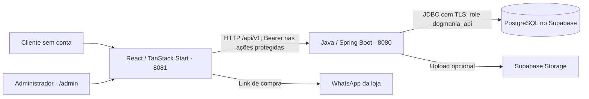

# Dogmania — palácio de memória do projeto

Última atualização: **08/11/2026** (America/Sao_Paulo).

Este é o arquivo único de contexto e relatório contínuo solicitado pelo usuário.
Uma nova IA deve começar por ele e pelo `AGENTS.md`, depois conferir os arquivos
que irá modificar. O resumo descreve o estado conhecido; o histórico preserva
as entregas. Não deduza que uma validação antiga continua válida após novas mudanças.

<a id="entrada"></a>
## 0. Entrada e retomada

Este é o **palácio de memória da Dogmania**, em Markdown e dentro do próprio
projeto. Ele reúne decisões, arquitetura, contratos, operação, incidentes e
histórico para continuar o trabalho sem depender da existência deste chat ou
de um fornecedor de IA. `AGENTS.md` e `README.md` apontam para este arquivo.
Existe um único histórico oficial: a seção 7 deste documento.

### 0.1. Cartão de retomada

| Pergunta | Resposta registrada |
| --- | --- |
| O que é o sistema? | Catálogo público da Dogmania Pet Shop; compra pelo WhatsApp e gestão por administradores. |
| Onde está o código real neste computador? | Raiz em `Desktop/Dogmania-Catalogo`; frontend na subpasta homônima e API em `backend-api/`. Conferir o caminho em outra máquina. |
| Como a aplicação se comunica? | Navegador → API Java → PostgreSQL no Supabase; Storage é opcional. |
| Como iniciar na instalação já configurada? | `Iniciar Dogmania.cmd` na raiz; frontend 8081 e API 8080. Ver seção 5. |
| Última operação real confirmada? | 06/11/2026: Supabase ativo, API e frontend reiniciados, catálogo com 6 ativos e conta administrativa ativa (038). O último login real confirmado com senha foi em 21/10/2026 (032). |
| O que foi conferido em 08/11/2026? | Circulação dos 22 pets nos três cenários de atividade, variedade de destinos e colisão nos vasos (044), além do ciclo de passada nos dois sentidos no Chromium (045). A recuperação do Supabase e dos serviços locais está na entrada 038. |
| Último commit local encontrado? | `921e8a5` — Atualiza catálogo, navegação e configuração local da Dogmania. A consulta local não comprova o estado atual do remoto. |
| O que ainda não foi publicado? | Relatos 031/032, organização da memória, Sala dos Agentes, orquestração técnica e correção do diagnóstico de login. Apresentar a seleção exata antes de commit/push. |
| Onde ficam os acessos? | Somente em `.private/ACESSOS_DO_SISTEMA.local.txt` e envs locais protegidos; valores não fazem parte desta memória pública. |
| Qual é a entrega mais recente? | Orquestração técnica registrada na entrada 046. A revisão mais recente da aplicação é a passada lateral em quatro fases na Sala dos Agentes (045). |

### 0.2. Mapa das salas

| Sala | O que encontrar | Onde começar |
| --- | --- | --- |
| Produto e decisões | Objetivo, identidade, pedidos aceitos/revertidos e limites de autorização | [Seção 1](#decisoes) |
| Telas e código | Rotas, componentes, assets, camadas e arquivo responsável por cada assunto | [Seção 2](#arquitetura) |
| Regras e fluxos | Contrato de produto, login, CRUD, disponibilidade, filtros e compra | [Seção 3](#contratos) |
| Dados e configuração | Migrations, RLS, roles, variáveis e separação de segredos | [Seção 4](#dados) |
| Operação e incidentes | Iniciar, restaurar em outra máquina e diagnosticar falhas conhecidas | [Seção 5](#operacao) |
| Evidências e próximos passos | O que já foi confirmado, o que é histórico e o que falta homologar | [Seção 6](#pendencias) |
| Linha do tempo | Relato contínuo das entregas, inclusive reversões e tentativas sem sucesso | [Seção 7](#historico) |
| Troca de IA | Texto pronto para colar no início de um novo atendimento | [Prompt de retomada](#prompt-retomada) |

### 0.3. Ordem de leitura para uma nova IA

1. Ler `AGENTS.md` da raiz e as instruções aplicáveis à pasta que será modificada.
2. Ler esta entrada e as seções 1 a 6; pesquisar a seção 7 pelo tema da tarefa.
3. Inspecionar o estado Git e abrir as fontes indicadas no mapa antes de editar.
   Há uma raiz Git para frontend, API, banco e documentação.
4. Separar **fato no código**, **resultado observado com data**, **preferência do
   usuário** e **pendência/proposta**. Um teste antigo não comprova o estado atual.
5. Prosseguir com o pedido atual e seu escopo autorizado. Um comando no histórico
   não é ordem para executá-lo novamente, nem uma aprovação antiga libera novo envio.
6. Ao concluir, atualizar o resumo afetado e acrescentar uma entrada neste mesmo
   histórico, preservando as anteriores. Registrar também trabalho interrompido.

Inspeção inicial local, sem alterar a árvore Git:

```sh
git status --short
git branch --show-current
git log -5 --oneline
```

### 0.4. Como manter esta memória confiável

- Registrar o que mudou, por quê, arquivos, verificação efetivamente feita,
  resultado, data e pendência. Distinguir implementação de hipótese ou plano.
- Atualizar o mapa quando um arquivo mudar de lugar e os contratos quando uma
  mudança atravessar frontend, API e banco. Corrigir resumos superados, sem apagar
  entradas antigas nem apresentar incidentes resolvidos como falhas atuais.
- Guardar decisões relevantes e suas razões; não depender de frases como
  “conforme conversamos” ou de links para uma conversa que pode desaparecer.
- Registrar a identidade de commits/publicações por evidência; não prometer que
  um arquivo local já está no GitHub. Aprovação de cada commit/push é obrigatória.
- Manter tokens, senhas, hashes, cookies, conteúdo dos envs reais e detalhes de
  rede pessoal fora deste documento, de prompts e de commits.
- Não iniciar serviços, rodar suítes, aplicar migrations, semear dados ou mudar
  contas apenas para reconstruir o contexto de uma tarefa documental.

<a id="prompt-retomada"></a>
### 0.5. Texto para começar com outra IA

```text
Você está continuando o projeto Dogmania Pet Shop. O contexto durável está no
arquivo CONTEXTO_DO_PROJETO.md, na raiz do repositório.
Leia primeiro AGENTS.md, a entrada da memória e as seções 1 a 6; consulte o
histórico da seção 7 e as instruções das pastas conforme a tarefa.
Confira o código real e git status antes de alterar; preserve mudanças locais
que não sejam suas. Não trabalhe em cópias de .tools/publish-review.
O cliente usa o catálogo sem conta. Administradores usam a API Java com JWT;
a API acessa o PostgreSQL Supabase por JDBC e TLS. Não há senha de demonstração.
Resultados antigos, permissões de ferramentas e processos de outro atendimento
não devem ser tratados como atuais. Não reaplique seed, migrations ou bootstrap
em uma instalação já configurada por causa de um relato antigo.
Atualize o mesmo CONTEXTO_DO_PROJETO.md em toda entrega com mudanças.
Coordene os agentes disponíveis para cada pedido e obtenha revisão independente
de cada implementação, conforme o AGENTS.md. Informe limitações de disponibilidade.
Nunca exponha credenciais. Commit e push exigem minha aprovação explícita para
o conteúdo, mensagem e destino apresentados. Aguarde meu pedido de trabalho.
```

O arquivo conserva o contexto técnico e as decisões disponíveis, não uma
transcrição literal de todas as mensagens nem a memória interna de uma IA.
Ele não substitui o banco, os assets, o código ou o documento privado de acessos.
Para perder apenas o chat, basta conservar a pasta do projeto. Para recuperar
após perder o computador, é necessário também ter cópia do código/documentação
publicados com aprovação e recuperação privada dos acessos e do banco.

<a id="decisoes"></a>
## 1. Objetivo e decisões do usuário

**GitHub:** toda entrega com alterações deve ser preparada para envio, mas o
usuário exige aprovação explícita antes de cada commit e push. Apresentar conteúdo,
verificações, mensagem e destino antes de executar. Não há autorização permanente
para enviar mudanças automaticamente. Nunca incluir segredos, chaves, dumps ou
configurações locais. A regra está detalhada no `AGENTS.md`.

Destino escolhido pelo usuário: `https://github.com/GustavoKenz0/DogMania-Catalogo.git`,
remote `origin`, branch local `main`. O repositório Git foi inicializado nesta
raiz, abrangendo frontend, backend, banco e documentos. Em 19/10/2026, o usuário
aprovou o primeiro commit e push, com a mensagem “Adiciona projeto completo da
Dogmania e documentação”, para `origin/main`. Conferir o resultado e sincronização
pelo histórico Git e pelas refs remotas; a existência do remote não comprova envio.
Essa aprovação vale somente para a entrega inicial revisada. Novas entregas
continuam exigindo aprovação própria antes de commit e push.

Catálogo digital da Dogmania Pet Shop, em Maringá, com compra iniciada pelo WhatsApp.
Clientes navegam sem conta. Somente administradores fazem login e gerenciam produtos.
O painel precisa ser intuitivo para pessoas sem familiaridade com sistemas:
ações com texto, formulários claros, feedback de erros e confirmação de exclusão.

O projeto começou somente com frontend e dados locais. O usuário posteriormente
adicionou Java e Supabase e autorizou a refatoração completa e testes de segurança.
Portanto, a restrição histórica de trabalhar apenas no frontend foi superada
por esse pedido. As próximas mudanças devem respeitar o escopo solicitado em cada tarefa.

Identidade e conteúdo existentes a preservar:

- Azul e dourado da marca, logo fornecida pelo usuário e fotos reais de pets nos banners.
- Endereço: Av. Humaitá, 299, Zona 04, Maringá–PR, CEP 87014-200.
- Telefones: (44) 3225-0871 e (44) 3031-7871.
- WhatsApp solicitado: `554499865542`, usado nos links de compra.
- Instagram: `https://www.instagram.com/dogmaniamaringa/`.
- A área administrativa não tem link público no rodapé. `/dogmania-painel` é um
  atalho para `/admin`; ocultar uma URL não substitui autorização na API.

### 1.1. Decisões que não devem se perder entre atendimentos

| Assunto | Estado vigente e razão | Rastreio no histórico |
| --- | --- | --- |
| Experiência do cliente | Catálogo sem cadastro/login; compra iniciada pelo WhatsApp da loja. Não existe checkout ou pagamento implementado. | 001, 015–016 |
| Administração | Login exclusivo da equipe; cadastro, edição, exclusão e pausa de disponibilidade de produtos com autorização na API. | 001, 013–014 |
| Persistência | Java + PostgreSQL Supabase substituíram a fase somente frontend/dados locais. Não restaurar CRUD em localStorage ou catálogo fictício como fallback. | 001, 008, 013 |
| Identidade visual | Preservar logo fornecida, azul/dourado e fotografias reais de pets; referências visuais não substituem a marca da Dogmania. | Histórico inicial consolidado, 015–016 |
| Header | Home e catálogo compartilham CatalogHeader; detalhe individual usa SiteHeader. Categorias mantêm navegação e busca por URL. | 015–016, 025–028 |
| Subcategorias | A primeira implementação foi revertida; depois foram solicitadas novamente com dropdown. O estado atual inclui subcategorias e reaproveita a migration existente. | 017–018, 025–026 |
| Clique na categoria | Abre todos os produtos daquela categoria; o dropdown continua disponível por hover e botão separado em toque. | 026 |
| Conteúdo do dropdown | Excluídos título repetido, Ver todos os produtos, Adestramento e Comportamento, Raças e Marcas. Não reintroduzir pelo simples fato de constarem em uma referência antiga. | 026 |
| Animação | Mini bounce do desenho ao hover/foco, inclusive com reduzir movimento por pedido explícito. A Sala dos Agentes permite caminhar com movimento reduzido e tem um controle próprio de pausa (041). | 019–024, 027–028 |
| Escurecimento | Fundo abaixo do header, não sobre o cabeçalho; fade reversível de entrada/saída e tolerância ao retirar o ponteiro. | 027–028 |
| Rodapé | Compacto e organizado, com endereço, horários, telefones, WhatsApp e Instagram; sem estimativas de minutos de transporte. | Pedidos iniciais consolidados, SiteFooter |
| Sala dos Agentes | Escritório redesenhado em SVG pixelado a partir da planta de referência. Cães e gatos em pixel art circulam em trabalho e repouso, com memória de destinos, desvio de obstáculos, identificação e diálogos ilustrativos. O coletor local registra metadados por projeto. | 034, 039, 040–045 |
| Orquestração técnica | O agente principal coordena especialistas disponíveis para cada pedido da Dogmania, com revisão independente de cada implementação e registro das validações. A regra está no [AGENTS.md](AGENTS.md#orquestração-e-revisão-técnica). | 046 |
| Relatório único | Atualizar este arquivo em cada entrega; não espalhar o histórico entre novos relatórios. | 002, 033 |
| Publicação | Preparar e revisar, depois obter aprovação específica para commit/push. Uma permissão antiga não autoriza novas publicações. | 003–004, 009, 029–030 |

Horários **presentes no código em 25/10/2026**: segunda a sexta 08:30–19:00,
sábado 08:30–13:00 e domingo fechado. O pedido inicial mencionou 08:00 no sábado,
enquanto a imagem posterior e o código usam 08:30. Preservar o estado atual nesta
tarefa documental e confirmar com o responsável antes de alterar esse horário.

<a id="arquitetura"></a>
## 2. Arquitetura e pontos de entrada

Checkout local encontrado em 19/10/2026: `C:\Users\Gustavo Kenzo\Desktop\Dogmania-Catalogo`.
A pasta anterior em Downloads não existe mais. `.tools/publish-review/` contém
uma cópia de revisão, não o código fonte em uso; editar `backend-api/` e o
frontend reais na raiz.

`.vscode/settings.json` é compartilhado como configuração de projeto segura:
exclui `.tools/` da importação Java/Maven e de recursos do servidor Java,
além de busca/watchers/explorador, evitando analisar cópias antigas como fontes.
Os outros arquivos do editor continuam ignorados. Os diagnósticos das fontes reais
não são desativados; reiniciar/limpar o workspace Java pode ser necessário para
remover importações antigas do cache do editor.
A extensão Red Hat Java 1.57.0 também apresentou regressão confirmada com construtores
Lombok/Java 21: neste computador foi instalada e fixada a 1.56.0. Recarregar a
janela ativa para adotá-la. Ver README e entrada 012; a instalação não viaja no Git.
O backend usa lombok.config com contratos Spring; análise de nulidade permanece ativa.

```text
Dogmania-Catalogo/                  frontend React/TypeScript/TanStack Start
  src/routes/                      páginas e metadados do roteador
  src/features/admin/              login, painel, editor e lista de produtos
  src/features/products/model.ts   tipos e categorias
  src/features/products/whatsapp.ts mensagens e links de compra
  src/config/store.ts              número oficial de WhatsApp
  src/lib/api.ts                   HTTP, DTOs, autenticação e upload
  src/lib/currency.ts              preço em BRL
  src/hooks/useProducts.ts         consultas e sincronização do catálogo
  src/components/                 vitrine, header, footer e carrossel
backend-api/                       Java 21, Spring Boot, JPA e Spring Security
  src/main/java/com/dogmania/api/   controller, service, repository, model,
                                   dto, security, config e exception
  src/test/                        testes Java isolados
supabase/                          migrations, seed e configuração de Storage
  tests/                           contrato SQL e runner PostgreSQL WASM
tests/                             smoke HTTP local e evidências históricas
```

O navegador chama a API Java. A API acessa o PostgreSQL hospedado no Supabase por
JDBC. O frontend não recebe senha de banco nem chave `service_role`.

Rotas públicas: `/`, `/produtos`, `/produto/$id`.
Rotas administrativas: `/admin` e o atalho `/dogmania-painel`.
`src/routeTree.gen.ts` é gerado pelo TanStack; altere os arquivos de rotas, não
o arquivo gerado. Preserve o wrapper de configuração Lovable e os componentes
de tratamento de erro que continuam em uso.

A home / e a página /produtos compartilham CatalogHeader branco, com busca e navegação por
animais/departamentos. Categorias atuais do frontend: Cães, Gatos, Pássaros,
Peixes, Outros Pets, Rações, Higiene e Brinquedos; o editor administrativo compartilha
a lista. Rótulos Cachorro/Gato/Pássaro/Peixe no menu preservam os valores de categoria
correspondentes. Busca e categoria são controladas pelos parâmetros busca/categoria
na URL e aplicadas ao catálogo real. Na entrada 025, dropdowns ancorados foram
adicionados novamente por pedido explícito, com links para subcategoria na URL.
Cachorro contém 13 opções após a simplificação da entrada 026; demais categorias
usam listas correspondentes. O nome da categoria navega para todos os seus produtos;
hover abre o dropdown e uma seta separada faz essa abertura em dispositivos de toque.
Os painéis contêm somente os links de subcategoria, sem título nem Ver todos.
Enquanto um dropdown está aberto, uma camada preta com 52% de opacidade cobre
o conteúdo abaixo do limite real do header; cabeçalho e painel permanecem claros.
Clique na área escura fecha o menu. A camada permanece montada após hidratação,
com fade de 520 ms na entrada e 480 ms na saída, reversível ao retornar o mouse.
Saída por hover aguarda 280 ms; fora do estado aberto, a camada não recebe cliques
e termina oculta. Essa transição também fica ativa com reduzir movimento, seguindo
a preferência explícita do usuário por manter essas animações globais.
Todos continua sendo o acesso direto ao catálogo inteiro. taxonomy.ts centraliza
opções, validação e relações explícitas entre animais e departamentos.
A animação atual segue o vídeo enviado em 21/10/2026: com mouse/hover, o animal
surge crescendo à esquerda do nome, na mesma linha, com texto dourado e sublinhado.
Sem avatar circular, fundo de cartão ou deslocamento vertical do rótulo. O espaço
do ícone abre em 420 ms e o desenho cresce em 520 ms; a caixa mede 40 px, ou 32 px
em desktops entre 1024 e 1279 px. Categorias em painéis estreitos mantêm largura
fixa e rolagem própria. Em toque, os desenhos ficam visíveis; foco de teclado preservado.
Os estilos continuam compartilhados na home e catálogo. A pedido expresso do usuário,
a animação das categorias agora permanece ativa também com prefers-reduced-motion: reduce.
A exceção é global para todos os usos de CatalogHeader e limitada à árvore dos botões
de categoria; o restante da interface conserva suas regras de redução de movimento.
O desenho inteiro faz um mini bounce em catalog-pet-motion, separado da entrada
em catalog-pet-avatar: salto de 10 px e acomodação em 600 ms, após atraso de 280 ms,
uma vez por hover/foco, sem deslocar o texto. Usa transform no elemento interno
para não competir com o crescimento/rotação do elemento externo.
Na home, nomes de categorias, envio da busca e links do dropdown abrem /produtos com os filtros correspondentes;
no catálogo, os filtros continuam controlados pela URL. SiteHeader continua no
detalhe individual do produto. A home mantém o carrossel de fotos reais e quatro
destaques ativos da API, com atalhos por departamento e contato oficial.

Subcategorias voltaram a integrar o frontend e o contrato Java na entrada 025,
reutilizando a coluna e a migration 20261020010000_product_subcategories.sql já
aplicada e preservada na reversão. Nenhuma nova migration ou escrita em produtos
foi necessária. ProductEditor permite classificação opcional por categoria; a API
persiste e retorna subcategory. Produtos sem classificação permanecem na categoria
principal, sem classificação inferida pelo nome. Filtros específicos não inventam
resultados. Adestramento e Comportamento, Raças e Marcas foram retirados da lista
na entrada 026. Valores antigos já gravados não foram apagados do banco.

### 2.1. Mapa visual do sistema



O Supabase hospeda os dados. **A autenticação implementada é do Java**, usando
`admin_users`; não confundir com usuários ou sessões do Supabase Auth.
Arquivos de apoio da squad não transformam essa aplicação em outra arquitetura:
o código atual usa controllers, services, repositories, DTOs e entidades JPA.

### 2.2. Onde mexer conforme o pedido

Caminhos relativos à raiz deste repositório, para funcionar também em outro computador:

| Pedido | Fonte principal e dependências |
| --- | --- |
| Alterar a home | [index.tsx](Dogmania-Catalogo/src/routes/index.tsx), CatalogHeader, HeroCarousel e SiteFooter |
| Alterar o catálogo/filtros | [produtos.tsx](Dogmania-Catalogo/src/routes/produtos.tsx), [CatalogGrid.tsx](Dogmania-Catalogo/src/components/CatalogGrid.tsx), taxonomy e useProducts |
| Alterar o detalhe/compra | [produto.$id.tsx](Dogmania-Catalogo/src/routes/produto.$id.tsx), [ProductCard.tsx](Dogmania-Catalogo/src/components/ProductCard.tsx), [whatsapp.ts](Dogmania-Catalogo/src/features/products/whatsapp.ts) |
| Alterar navegação/dropdown/bounce | [CatalogHeader.tsx](Dogmania-Catalogo/src/components/CatalogHeader.tsx), [PetDrawing.tsx](Dogmania-Catalogo/src/components/PetDrawing.tsx) e [styles.css](Dogmania-Catalogo/src/styles.css) |
| Alterar categorias/subcategorias | [model.ts](Dogmania-Catalogo/src/features/products/model.ts), [taxonomy.ts](Dogmania-Catalogo/src/features/products/taxonomy.ts), ProductEditor e contrato Java |
| Alterar contato e rodapé | [store.ts](Dogmania-Catalogo/src/config/store.ts), [SiteFooter.tsx](Dogmania-Catalogo/src/components/SiteFooter.tsx); conferir links duplicados no footer |
| Alterar banners/logo | [HeroCarousel.tsx](Dogmania-Catalogo/src/components/HeroCarousel.tsx), CatalogHeader, SiteHeader e assets existentes; manter [créditos](Dogmania-Catalogo/src/assets/IMAGE_CREDITS.md) |
| Alterar login/painel | [AdminPage.tsx](Dogmania-Catalogo/src/features/admin/AdminPage.tsx), [api.ts](Dogmania-Catalogo/src/lib/api.ts), AuthController/AuthService e segurança Java |
| Alterar formulário/listagem admin | [ProductEditor.tsx](Dogmania-Catalogo/src/features/admin/ProductEditor.tsx), [ProductManagementList.tsx](Dogmania-Catalogo/src/features/admin/ProductManagementList.tsx) e ProductDTO |
| Alterar consultas/sincronização | [useProducts.ts](Dogmania-Catalogo/src/hooks/useProducts.ts), api.ts e [ProductRepository.java](backend-api/src/main/java/com/dogmania/api/repository/ProductRepository.java) |
| Alterar regra de produto | [ProductService.java](backend-api/src/main/java/com/dogmania/api/service/ProductService.java), [ProductDTO.java](backend-api/src/main/java/com/dogmania/api/dto/ProductDTO.java), [Product.java](backend-api/src/main/java/com/dogmania/api/model/Product.java) e migrations |
| Alterar autenticação/autorização | [SecurityConfig.java](backend-api/src/main/java/com/dogmania/api/config/SecurityConfig.java), [AuthService.java](backend-api/src/main/java/com/dogmania/api/service/AuthService.java), JwtTokenProvider, JwtAuthenticationFilter e CustomUserDetailsService |
| Alterar upload | [UploadService.java](backend-api/src/main/java/com/dogmania/api/service/UploadService.java), UploadController, api.ts e supabase/setup_storage.sql |
| Alterar auditoria/erros | [AuditService.java](backend-api/src/main/java/com/dogmania/api/service/AuditService.java), [GlobalExceptionHandler.java](backend-api/src/main/java/com/dogmania/api/exception/GlobalExceptionHandler.java) e triggers SQL |
| Alterar inicialização local | [iniciar-local.ps1](iniciar-local.ps1), [start-local.ps1](backend-api/start-local.ps1) e [Iniciar Dogmania.cmd](<Iniciar Dogmania.cmd>) |
| Alterar dependências | [package.json do frontend](Dogmania-Catalogo/package.json), seu bun.lock e [pom.xml](backend-api/pom.xml); não confundir com package.json da raiz |

### 2.3. Stack, assets e arquivos especiais

- Manifest do frontend em 25/10: React `^19.3.1`, TypeScript `^5.9.3`, Vite `^8.3.4`,
  Tailwind `^4.3.3`, TanStack Router `1.170.41` e Start `1.168.60`. As versões
  resolvidas devem ser conferidas no lockfile, não inferidas dos intervalos.
- Backend: alvo Java 21, Spring Boot `3.5.16`, Springdoc `2.8.17` e JJWT `0.12.7`
  no POM. JDK 26 foi usado neste computador em verificações anteriores; não é
  requisito para elevar o alvo da linguagem ou liberar recursos preview.
- O wrapper `@lovable.dev/vite-tanstack-config` já instala os plugins do frontend;
  não duplicar React, Tailwind, TanStack ou Nitro em vite.config.ts. O projeto
  continua conectado ao Lovable; preservar histórico publicado.
- TanStack usa `src/routes/` e o layout `__root.tsx`; não criar uma estrutura
  Next.js `app/`/`pages/` por causa de exemplos genéricos. routeTree.gen.ts é gerado.
- Banners locais: `banner-1.jpg`, `banner-2.jpg` e `banner-3.jpg`, com origem
  registrada em IMAGE_CREDITS.md. O carrossel usa Embla, intervalo de 6 segundos,
  controles e indicadores, com parada por interação/hover.
- Logos originais e versões preparadas estão em `src/assets/`; antes de apagar
  uma versão, conferir referências reais. Fotos de produtos locais não são um
  fallback autorizado para substituir silenciosamente dados da API.
- `.tools/` guarda cópias de revisão e auxiliares ignorados; `.vscode/settings.json`
  evita importar essas cópias como projetos Java. `tests/` guarda ferramentas que
  podem ter efeitos reais; ler o comando e o escopo antes de executar.
- Em 25/10 também existe um kit local `.agents/` com papéis, skills e regras de
  orquestração. Ele aparece não rastreado no Git, não foi alterado nesta entrega
  e não deve ser tratado como incluído num clone remoto. Seus exemplos genéricos
  não comprovam funcionalidades implementadas nem substituem instruções do usuário
  e regras aplicáveis. Não presumir que subagentes de um chat sobrevivam em outro.

### Sala dos Agentes

- Painel administrativo: **Sala dos Agentes**, em /admin?aba=agentes.
  [AdminPage.tsx](Dogmania-Catalogo/src/features/admin/AdminPage.tsx) reaproveita
  o login e carrega a sala apenas na sessão administrativa. O
  [escritório](Dogmania-Catalogo/src/features/admin/agent-office/AgentOffice.tsx)
  mostra perfis, estações, descanso, reuniões e linha do tempo. O
  [modelo da sala](Dogmania-Catalogo/src/features/admin/agent-office/model.ts)
  concentra a equipe base, nomes, estilos e a fila visual de reuniões.
- O [cenário em SVG](Dogmania-Catalogo/src/features/admin/agent-office/OfficeMap.tsx)
  reproduz em pixel art as salas e o mobiliário da referência. A
  [planta de circulação](Dogmania-Catalogo/src/features/admin/agent-office/officeLayout.ts)
  define as divisórias, janelas, portas, obstáculos e destinos. A
  [navegação](Dogmania-Catalogo/src/features/admin/agent-office/officeNavigation.ts)
  planeja rotas com espaço para o corpo do avatar. A
  [circulação compartilhada](Dogmania-Catalogo/src/features/admin/agent-office/officeTraffic.ts)
  verifica o espaço entre cães e gatos antes de cada passo. Os avatares
  usam outro acesso quando disponível e cedem a vez em passagens estreitas.
  Repouso é o estado de atividade exibido enquanto o avatar passeia.
  Em trabalho, visitas às estações se alternam com trajetos por áreas
  livres. Cada pet lembra até cinco destinos recentes e prioriza lugares
  diferentes. Em congestionamentos, a rota pode ceder passagem, trocar de
  destino ou usar um trajeto local. Os quatro vasos nos cantos integram
  os obstáculos da navegação. O tamanho é compartilhado entre o desenho e a
  navegação. Os sprites em SVG têm poses de frente e de perfil em uma grade
  18×18 com contorno escuro e bordas nítidas. De perfil, os pets têm corpo
  mais largo e quatro patas que alternam aos pares em quatro fases. O
  deslocamento pelo mapa continua com movimento reduzido, que desativa
  o ciclo de patas e o balanço do sprite. O botão Pausar caminhada
  congela as posições. O nome aparece ao passar o mouse, focar pelo
  teclado ou tocar no avatar.
  A rolagem horizontal permite explorar o escritório no celular.
- API de leitura: GET /api/v1/admin/agent-office, com JWT e papéis ADMIN ou
  SUPER_ADMIN, resposta sem cache. O
  [serviço Java](backend-api/src/main/java/com/dogmania/api/service/AgentOfficeService.java)
  resume arquivos locais. O frontend consulta a cada 1,5 segundo enquanto a
  aba está visível. Sem eventos, a sala mostra a equipe em repouso e o aviso
  de que aguarda o Codex.
- Coleta: [instalador](scripts/agent-office/install-hooks.mjs) e
  [coletor](scripts/agent-office/record-event.mjs), executados com Node.
  O diário em .private/agent-office é local ao computador da API e ignorado
  pelo Git. Somente horários, tipos, perfis e identificadores com hash são
  armazenados. O cenário não lê transcrições. Não existe endpoint para escrever
  eventos e a sala não requer migration.

<a id="contratos"></a>
## 3. Regras e contratos que atravessam as camadas

- Produto: ID UUID, nome, descrição, preço, categoria, subcategoria opcional, imagem HTTPS, selo opcional
  e disponibilidade. Java/banco usam `name`; JSON usa `title`, aceita `name`
  como alias de entrada; `lib/api.ts` converte para o modelo do frontend.
- Valores monetários usam `BigDecimal` na API e `numeric(10,2)` no banco.
- Produto sem estoque (`active=false`) continua no painel, mas sai da vitrine,
  buscas, destaques, relacionados e consulta pública individual.
- Pausar estoque é reversível. Excluir é definitivo, com confirmação na interface.
- Não existe fallback para catálogo estático, CRUD em localStorage ou senha de
  demonstração. Uma falha de API deve aparecer como erro, sem sucesso fictício.
- Sessão usa Bearer JWT em `sessionStorage`, expiração e `/auth/me`. ADMIN e
  SUPER_ADMIN podem administrar. A API consulta o estado da conta em cada acesso.
- Login usa BCrypt e limite por IP. Logout remove o token no cliente; não há
  refresh token nem lista de revogação imediata de tokens individuais.
- As consultas públicas/admin têm caches distintos. BroadcastChannel e atualização
  periódica sincronizam o catálogo. O detalhe deve tratar 404 mesmo com dados em cache.
- Upload passa pela API autenticada: JPEG/PNG/WebP, até 5 MiB, assinatura inicial
  validada, nome UUID e destino Supabase Storage. Não é antivírus/transcodificação.

Base da API: `http://localhost:8080/api/v1`.

| Operação | Endpoint |
| --- | --- |
| Login e sessão | POST `/auth/login`, GET `/auth/me` |
| Catálogo público | GET `/products`, GET `/products/{id}` |
| Relacionados | GET `/products/{id}/related` |
| Lista administrativa, incluindo inativos | GET `/admin/products` |
| Cadastrar / editar / excluir | POST `/products`, PUT/DELETE `/products/{id}` |
| Estoque | PATCH `/products/{id}/availability`, corpo `{ "active": false }` |
| Foto | POST `/uploads/image`, multipart `file`, resposta `{ "url": "https://..." }` |

O contrato detalhado e os limites estão em `backend-api/README.md`.

### 3.1. Fluxos completos para raciocinar sobre uma mudança

**Catálogo e filtros:** a rota lê `busca`, `categoria` e `subcategoria`. useProducts
busca páginas da API (até 100 por página) e mantém cache público separado do admin;
CatalogGrid/taxonomy aplicam os filtros da navegação. A API também oferece busca
por `q` e `category`, mas não presumir que o frontend atual envie todos os filtros
para o servidor. Slugs e relações de subcategoria são definidos em taxonomy.ts;
produto sem classificação não deve ganhar uma categoria por inferência do nome.

**Login:** AdminPage → api.login → POST /auth/login → limite por IP → autenticação
BCrypt da conta ativa em admin_users → JWT → sessionStorage com expiração →
/auth/me para reconhecer a sessão. Escritas usam Authorization Bearer e passam
por Spring Security; esconder uma rota ou botão não faz autorização. Há limite
de 10 tentativas de login por IP em 5 minutos por instância, incluindo acertos.
O navegador descarta a sessão expirada e o backend revalida a conta a cada acesso.
Não há fluxo de criação de contas de clientes ou registro público de admins.

**CRUD e disponibilidade:** ProductEditor/AdminPage → api.ts → controller →
validação DTO → ProductService transacional → repository/JPA → constraints/RLS
PostgreSQL → trigger de auditoria → DTO → atualização de consultas. A mutação
invalida caches e avisa outras abas via BroadcastChannel; refetch periódico ocorre
em 30 segundos, com staleTime de 10 segundos. Pausar preserva o registro; excluir
remove o produto. A ação de exclusão exige confirmação na interface.

**Compra:** ProductCard ou detalhe cria um link wa.me com mensagem de produto,
para o número em store.ts. O sistema não processa pagamento, entrega ou pedido
interno. Não inventar um carrinho ou checkout já existente.

**Imagem:** URL HTTPS pode ser informada no editor. Envio de arquivo usa a API
protegida e Storage opcional; os bytes iniciais e o tamanho são validados antes
do envio. Chave de serviço permanece no backend. Storage desligado retorna 503,
e upload falho não equivale a produto salvo com sucesso.

### 3.2. Limites e diferenças que atravessam o contrato

| Campo/assunto | Contrato atual a preservar e verificar nas fontes |
| --- | --- |
| Nome | Frontend chama name; DTO JSON responde title e aceita name como alias. DTO exige não vazio e até 150; banco exige pelo menos 2 caracteres após trim. |
| Descrição | Obrigatória no DTO, até 2000 caracteres. |
| Preço | Obrigatório, positivo; BigDecimal e numeric(10,2), até 8 inteiros e 2 decimais; banco rejeita NaN. |
| Categoria | CATEGORIES controla opções do frontend; backend exige texto não vazio até 50 e o banco mínimo de 2 após trim. Não existe enum SQL das oito opções. |
| Subcategoria | Opcional; quando enviada deve ter 2–80 caracteres. Serviço normaliza valor e banco tem CHECK; a lista editorial de opções vive no frontend. |
| Imagem | Obrigatória, URL HTTPS sem espaços e até 2048 caracteres; upload separado limita bytes a 5 MiB. |
| Badge | Opcional, até 50 caracteres no DTO. |
| active | Cadastro assume true quando omitido; edição preserva se não fornecido; false não aparece em endpoints públicos. |
| Paginação/ordenação | API limita páginas a 100 itens e aceita apenas campos de ordenação explicitamente listados no ProductService. |
| Falha de transporte | api.ts usa timeout de 15 s e ApiError com status 0. Não confundir com 401 (autenticação), 403 (autorização), 404 (ausente/inativo), 409 (constraint) ou 429 (limite de login). |

Esses limites descrevem a implementação atual, não afirmam que todas as camadas
validam de forma idêntica. Por exemplo, o mínimo de nome/categoria no banco é mais
estrito que as anotações do DTO. Uma futura alteração precisa conferir os dois
contratos e os campos exibidos pelo editor, sem ajustar o banco às cegas.

<a id="dados"></a>
## 4. Banco e segurança

Migrations existentes, nesta ordem:

1. `supabase/migrations/20261019_initial_schema.sql` — schema histórico.
2. `supabase/migrations/20261020000000_java_contract_and_access.sql` — alinha os
   campos ao Java, corrige roles e aplica o modelo atual de acesso. O nome da
   migration é o identificador existente; preserve a ordem, não renumere silenciosamente.
3. `supabase/migrations/20261020010000_product_subcategories.sql` — coluna opcional
   subcategory, CHECK de comprimento, índice parcial e classificação dos exemplos
   conhecidos por UUID/nome exatos. Aplicada nesta instalação em 20/10/2026.
   Reutilizada pela aplicação na entrada 025; não reaplicar na instalação atual.

Tabelas: `products`, `admin_users`, `audit_logs`. A role de runtime `dogmania_api`
não é dona das tabelas e não possui bypass RLS. Papéis da Data API Supabase não
recebem grants nas tabelas da aplicação; o catálogo público também passa pelo Java.
Essa RLS distingue a identidade do servidor, não cada pessoa autenticada no Java.

Triggers produzem auditoria das alterações de produtos na transação. O Java não
persiste diretamente em `audit_logs`. O banco registra a identidade da conexão;
logs da aplicação complementam o administrador autenticado. Após bootstrap,
revogar INSERT em `admin_users` reduz os privilégios de runtime.

Em 20/10/2026, a pedido do usuário, seis produtos fictícios [EXEMPLO] foram
cadastrados pela API e confirmados por JDBC independente no Supabase real configurado:
cinco ativos e um sem estoque. Dados e UUIDs estão na entrada 013. Ferramenta repetível
em tests/catalog/criar-e-validar-exemplos.ps1, com fixtures e verificador JDBC;
a repetição não duplica exemplos idênticos nem sobrescreve exemplos editados.

`supabase/seed.sql` contém produtos de desenvolvimento, sem administrador fixo.
`supabase/setup_storage.sql` configura opcionalmente o bucket público `product-images`.
Revisar policies antigas de Storage antes de usar o bucket com dados reais.

Nenhuma migration, credencial ou configuração foi aplicada ao Supabase remoto
durante a refatoração de 19/10/2026. Se um seed antigo com conta compartilhada já
foi aplicado, a conta deve ser desativada ou ter a senha trocada pelo responsável.

Posteriormente, o usuário criou o projeto Supabase e aplicou as duas migrations
pelo SQL Editor. Em 19/10/2026, a configuração remota foi confirmada por JDBC:
três tabelas com RLS, role restrita habilitada com SCRAM-SHA-256, conexão da role
validada com CA oficial e hostname/TLS verificados. A API iniciou, validou o schema
com Hibernate e criou o primeiro administrador. Login e listagens foram confirmados
após recarga com bootstrap desativado; sua senha foi removida do `.env.local`.

Em 20/10/2026 foi criada também uma conta administrativa adicional, ativa, com
perfil ADMIN. E-mail e senha definidos pelo responsável estão somente no documento
privado de acessos; login e /auth/me confirmados. A conta anterior foi preservada.

Por solicitação expressa do usuário, os acessos de operador PostgreSQL, runtime
e administrador do site estão exclusivamente em
`.private/ACESSOS_DO_SISTEMA.local.txt`. O arquivo contém senhas legíveis e
possui DACL restrita ao usuário atual e SYSTEM; isso não criptografa o conteúdo.
Não copiar valores para contexto público, logs ou mensagens. A pasta inteira
`.private/`, os envs reais e `.tools/` estão ignorados pelo Git.

### 4.1. Memória do modelo de dados e privilégios

| Área | Dados e invariantes | Acesso esperado |
| --- | --- | --- |
| products | UUID, name, description, price, category, subcategory opcional, image, badge, active, sort_order e timestamps; dinheiro positivo/finito e constraints descritas acima | dogmania_api faz CRUD; visibilidade pública é filtrada pelo Java |
| admin_users | UUID, name, email único também sem distinguir caixa, password_hash BCrypt, role ADMIN/SUPER_ADMIN, active e timestamps | Runtime lê para autenticar; INSERT é de bootstrap e deve permanecer revogado após a configuração conforme o procedimento |
| audit_logs | UUID, action, entity_type, entity_id, performed_by, details e created_at; append-only | Trigger registra produto na mesma transação; runtime não recebe escrita direta |

Não usar um eventual advisory de ausência de policy em audit_logs como motivo para
abrir a tabela: a ausência de acesso público é intencional. O audit de produto
registra a identidade de conexão; AuditService registra ator autenticado/login
no log da aplicação. Não há FK de conta Supabase Auth por trás do login Java.
As migrations são a definição versionada do schema; entidades JPA não aplicam DDL
porque `ddl-auto` é validate.

### 4.2. Catálogo de configuração, sem valores privados

Fontes públicas: [application.yml](backend-api/src/main/resources/application.yml),
[exemplo do backend](backend-api/.env.example) e
[exemplo do frontend](Dogmania-Catalogo/.env.example).

| Variável ou grupo | Onde é usada | O que a próxima IA precisa saber |
| --- | --- | --- |
| VITE_API_URL | Frontend | Base pública da API, normalmente http://localhost:8080/api/v1; VITE_* vai ao navegador |
| SUPABASE_DB_URL | Backend | JDBC do banco; usar host/método reais configurados e TLS verify-full com CA; não publicar a configuração local |
| SUPABASE_DB_USER / SUPABASE_DB_PASSWORD | Backend | Login da role restrita, não operador postgres; senha somente no arquivo privado/ambiente |
| JWT_SECRET_KEY / JWT_EXPIRATION_MS | Backend | Assinatura privada e validade; default de expiração 3600000 ms; não regenerar segredo por uma falha de rede |
| CORS_ORIGINS | Backend | Origens exatas do frontend, incluindo http://127.0.0.1:8081; localhost e 127.0.0.1 são origens distintas |
| SERVER_PORT | Backend | Padrão 8080; alinhar frontend, iniciador e URLs se houver mudança |
| API_DOCS_ENABLED | Backend | Documentação desligada por padrão; rotas de docs também estão protegidas no SecurityConfig |
| DOGMANIA_BOOTSTRAP_ADMIN_ENABLED / EMAIL / PASSWORD | Bootstrap Java | Opt-in de primeiro admin; desativar e remover a senha do env após a configuração; não é mecanismo de redefinição de senha |
| STORAGE_ENABLED / SUPABASE_URL / SUPABASE_SERVICE_ROLE_KEY | Backend | Upload opcional ao bucket product-images; habilitar só com configuração válida; nunca enviar service key ao navegador |

**Arquivos reais privados:** `.private/ACESSOS_DO_SISTEMA.local.txt`,
`backend-api/.env.local`, `Dogmania-Catalogo/.env.local` e certificado local.
Nenhum deles deve ser lido inteiro no chat ou incluído num pacote público de memória.
Nomes de variáveis e caminhos bastam para orientar uma configuração autorizada.

Os scripts de configuração podem criar e trocar credenciais; não são necessários
para abrir todos os dias uma instalação que já funciona. `start-local.ps1 -Check`
só confirma presença de arquivo/ferramentas; não valida rede, senha ou JDBC.
O Supabase MCP conectado em 21/10 permitiu inspeção via HTTPS; isso não transforma
o runtime da aplicação numa integração REST e não prova que a porta JDBC local
esteja acessível. O acesso de ferramenta precisa ser reconfirmado em cada atendimento.

<a id="operacao"></a>
## 5. Como executar e validar

No Windows já configurado, o ponto de entrada simplificado é
`Iniciar Dogmania.cmd`, na raiz. Ele chama `iniciar-local.ps1`, abre os
serviços em janelas separadas, reaproveita serviços disponíveis, aguarda respostas
da API/site e abre o navegador. Fechar as janelas dos serviços ou usar Ctrl+C
encerra o uso local. Nenhum provisionamento ou instalação automática é disparado.

Pré-requisitos: JDK 21, Maven 3.9 e Bun; banco Supabase configurado.

Conectividade: a rede do computador precisa permitir a saída TCP para o Session
pooler na porta 5432. Em 21/10/2026, o catálogo e o login ficaram indisponíveis
porque a API não conseguia acessar o banco a partir da rede de visitantes da
instituição. Após confirmar a troca real para o roteador do celular com dados
móveis, a conexão, a API e o login voltaram sem mudar senhas, grants ou RLS.
Se ocorrer novamente, conferir a rede ativa e Test-NetConnection antes de
reprovisionar o banco ou redefinir acessos. Usar uma rede permitida ou solicitar
à administração da rede a liberação necessária; não enfraquecer TLS/firewall.

1. Seguir `supabase/README.md` para migrations, role de runtime e conexão TLS.
2. Configurar as variáveis de `backend-api/.env.example` na IDE/no ambiente ou
   executar `backend-api/configure-local.ps1`. O configurador lê senhas ocultas,
   gera JWT aleatório e grava `.env.local` com ACL restrita ao usuário e SYSTEM.
   Spring carrega esse arquivo opcional no diretório `backend-api/`; ambiente
   tem precedência. O exemplo e `.env` genérico não são carregados automaticamente.
   O primeiro admin usa bootstrap opt-in, depois desabilitado.
   Para um projeto novo já migrado, `setup-supabase.ps1 -PoolerHost HOST -ProjectRef REF`
   habilita a role via prompt local antes de chamar o configurador. Não repete migrations.
   O fluxo `complete-local.ps1` gera senhas e documento privado quando solicitado.
   Os assistentes obtêm o CA oficial e usam `sslrootcert` com `verify-full`.
   A instalação atual já está configurada: não repetir esses provisionamentos.
3. Em `backend-api/`: `mvn spring-boot:run` — API na porta 8080.
   No Windows, `.\start-local.ps1` encontra o Maven no PATH ou cache Wrapper;
   `-Check` valida a presença da configuração sem conectar e `-Test` roda testes
   sem exigir credenciais. Os scripts não executam migrations remotas.
4. Em `Dogmania-Catalogo/`: configurar `.env.local` a partir de `.env.example`;
   `VITE_API_URL=http://localhost:8080/api/v1` é pública, nunca colocar segredos nela.
   Executar `bun install` e `bun run dev` — site em `http://127.0.0.1:8081`.
5. Upload depende de `STORAGE_ENABLED`, `SUPABASE_URL` e
   `SUPABASE_SERVICE_ROLE_KEY`, somente no servidor. O serviço desligado retorna
   503; o editor também aceita URL HTTPS.

Verificações reproduzíveis:

| Pasta | Comando | Escopo |
| --- | --- | --- |
| `Dogmania-Catalogo/` | `bun run build` | cliente, SSR e Nitro |
| `Dogmania-Catalogo/` | `bun x tsc --noEmit` | tipos TypeScript |
| `Dogmania-Catalogo/` | `bun audit --json` | avisos npm conhecidos no momento |
| `backend-api/` | `mvn test` | testes Java, incluindo filtros de segurança reais |
| `supabase/tests/` | `bun install --frozen-lockfile`; `bun run test` | SQL em PostgreSQL WASM descartável |
| raiz | `powershell -NoProfile -File tests/security_attack_simulation.ps1 -BaseUrl http://127.0.0.1:8080/api/v1` | smoke HTTP local, sem escrita |

O runner de SQL omite as extensões opcionais históricas uuid-ossp/pgcrypto e simula
funções Supabase Auth somente para interpretar a primeira migration; a segunda
remove aquelas policies. Não valida JDBC/TLS ou Supabase hospedado.

### 5.1. Retomar sem chat ou em outro computador

**Mesmo computador, chat perdido:** abrir a raiz real, ler este documento e
AGENTS, conferir mudanças locais e usar o iniciador. Arquivos, dados e credenciais
não deixam de existir por trocar de chat; uma nova IA não precisa recriar admins
ou produtos para obter contexto.

**Outra máquina, mesmo Supabase:** obter o repositório/publicação aprovada e seus
arquivos de documentação; instalar dependências pelos manifests/locks; configurar
os envs por canal privado com os acessos autorizados existentes. Não aplicar
migrations/seed novamente só por ser uma máquina nova: o banco remoto continua
sendo o mesmo. Checar rede, TLS, CORS e contrato antes de operar sobre dados reais.

**Banco ou instalação novos:** confirmar que se trata realmente de um ambiente
novo e seguir README do banco/API, migrations em ordem e bootstrap opt-in.
Migrations podem alterar dados; seed e a ferramenta de exemplos gravam produtos.
A memória não contém dump e não restaura registros perdidos. Backup/restauração
do Supabase e recuperação privada das credenciais são procedimentos separados.

**Perda do computador:** a cópia deste arquivo no Git só existirá após commit e
push aprovados. Mudanças locais, `.agents/` não rastreada e arquivos privados não
estão automaticamente em backup. Nunca resolver isso versionando senhas.

### 5.2. Diagnóstico por sintoma

| Sintoma | Primeiras conferências | Aprendizado preservado |
| --- | --- | --- |
| Site não abre em 8081 | Pasta correta, dependências e processo do frontend; ler saída do iniciador | Navegador aberto não mantém servidor em execução |
| Site abre, catálogo falha e admin não entra | Conferir API 8080 e alcance TCP ao host real do banco antes de culpar a senha | API desligada causou os dois sintomas em 21/10 |
| Pooler expira, painel Supabase abre | Conferir rede ativa, porta 5432, origem da conexão e estado do projeto | HTTPS 443 e JDBC TCP 5432 são caminhos diferentes |
| Troca de internet relatada, erro persiste | Conferir qual rede o computador realmente usa; se celular, assegurar dados móveis independentes | A rede de visitantes ainda estava ativa no incidente; após troca confirmada para dados móveis funcionou |
| permission denied for table products no PostgREST | Identificar a origem da consulta e os grants da role em uso | Data API pública não recebe acesso à tabela; não liberar anon/authenticated para contornar um problema do Java |
| Login 401 com API acessível | Distinguir email/senha, expiração e conta ativa; conferir o acesso fornecido localmente | Não redefinir contas com base apenas em falha de transporte ou token antigo |
| Login 503 | Conferir disponibilidade do serviço de autenticação e conexão com o PostgreSQL | Credenciais inválidas continuam retornando 401. O frontend exibe a mensagem segura da API. |
| Login 429 | Conferir limite e aguardar janela; evitar tentativas repetidas | Limite por IP/instância também conta logins bem-sucedidos |
| Produto pausado some da vitrine | Conferir active e diferenças entre consulta pública/admin | É regra intencional, não exclusão do banco |
| Filtro de subcategoria vazio | Conferir URL, taxonomy e classificação realmente persistida | Produto sem subcategoria não pode ser classificado pelo nome apenas para preencher a tela |
| Ícone aparece, mas não salta | Conferir styles.css, wrappers separados e regras de reduzir movimento | A exceção global solicitada deve abranger o bounce sem afetar toda a UI |
| Erros Java em .tools/publish-review | Abrir fontes reais e conferir exclusões do VS Code | Essa pasta é cópia antiga, não outro backend para manter |
| Flexible Constructor Bodies em código Lombok | Comparar diagnóstico do editor com compilação e versão da extensão | Regressão da extensão foi contornada em 20/10 sem mudar o alvo Java 21 |
| Upload retorna 503 | Conferir ativação/configuração de Storage no backend | URL HTTPS no editor continua sendo o fluxo alternativo previsto |

Conferências manuais de conectividade, apenas quando necessárias e autorizadas:

```powershell
# Na raiz do checkout, sem imprimir conteúdo de envs reais:
Get-NetTCPConnection -State Listen -LocalPort 8080,8081 -ErrorAction SilentlyContinue
Invoke-WebRequest 'http://127.0.0.1:8080/api/v1/products?size=1'
Test-NetConnection -ComputerName 'HOST_REAL_DO_SESSION_POOLER' -Port 5432
```

Substituir o host pelo configurado, sem copiar senha ou URL com credenciais.
Capturas de rede, instalações, serviços externos de diagnóstico e alteração de
políticas não são passos automáticos deste roteiro. A autorização ao Check-Host
em 21/10 foi específica daquela verificação, não uma permissão permanente.

### 5.3. Encerramento de uma entrega e continuidade

1. Conferir quais arquivos já estavam alterados e preservar trabalho do usuário.
2. Consolidar os achados da revisão independente, verificar a versão integrada
   e identificar limitações na revisão ou nos testes.
3. Atualizar o resumo e a entrada do histórico único com data, papéis acionados,
   validações e pendências. Separar evidências atuais das históricas.
4. Rever diff, caminhos e segredos da seleção pública pretendida.
5. Apresentar conteúdo, mensagem e repositório/branch antes de pedir autorização
   para commit/push. Se o escopo mudar, apresentar a seleção atual novamente.
6. Depois de envio aprovado, confirmar commit e refs, registrar a evidência e
   deixar explícita qualquer pendência.

### Ativar o acompanhamento do Codex

1. Na raiz do checkout, com Node no PATH, execute o comando abaixo se a
   configuração local ainda não existir.

   ~~~powershell
   node scripts/agent-office/install-hooks.mjs
   ~~~

   O instalador cria .codex/hooks.json com caminho absoluto para o coletor.
   Se já houver um arquivo, ele exibe a configuração para mesclar e preserva a
   versão existente. Não publique esse arquivo local.
2. Abra o projeto no Codex e revise os hooks em **Settings → Hooks** ou
   **Review hooks**, depois autorize os hooks do projeto. Abra uma nova sessão
   nesse checkout se a sessão anterior ainda não tiver carregado a configuração.
3. Inicie a Dogmania normalmente, entre com o login administrativo existente e
   abra **Sala dos Agentes**. Uma tarefa iniciada em uma sessão instrumentada
   deve produzir o primeiro sinal.
4. Se o Java for iniciado fora da pasta backend-api, configure
   DOGMANIA_AGENT_OFFICE_JOURNAL com o caminho da pasta .private/agent-office
   da instalação. O padrão relativo pressupõe backend-api como diretório de
   trabalho. Para sessões em outro computador, este diário local não sincroniza
   automaticamente.

Uma delegação registrada ou uma solicitação de contato entre IDs reconhecidos
entra na fila visual quando os dois participantes estão ativos. Os balões
ilustram a conversa sem exibir a mensagem original. O encerramento volta a
colocar o avatar em repouso. Atividade sem novos sinais por 45 minutos expira
para evitar avatares presos após uma queda. A interface mostra as 30 atividades
recentes do diário, com janela de 24 horas e limite de 1.500 eventos lidos.

<a id="pendencias"></a>
## 6. Últimas evidências e pendências conhecidas

**Retomada em 25/10/2026:** esta entrega conferiu fontes e documentação, sem
iniciar serviços ou acessar o banco. A última operação real confirmada continua
sendo 21/10: catálogo com seis ativos, painel com sete produtos e login ADMIN
restabelecidos na entrada 032. Os parágrafos datados de 19/10 abaixo são registros
históricos e não descrevem um catálogo atualmente vazio. Ver também 6.1 e 6.2.

Validações de base registradas em **19/10/2026** (históricas):

- Build frontend e TypeScript aprovados; auditoria npm retornou `{}`, exit 0.
- Java: 31 testes aprovados, zero falhas/erros/ignorados, repetidos após atualizar
  Spring Boot para 3.5.16, Springdoc para 2.8.17 e JJWT para 0.12.7.
- SQL: duas migrations, seed e contrato de grants/RLS/CRUD/preços/auditoria passaram
  em PGlite 0.5.10. Não há administrador padrão criado pelo seed.
- Configuração local adicional: `mvn clean test` pelo launcher Java/Maven passou
  com 29 fontes recompiladas e 31 testes aprovados no Oracle JDK 26/Maven 3.9.16.
  Processador Lombok agora é explícito no POM (necessário no compilador instalado).
  Os scripts foram exercitados com credenciais sintéticas em pasta isolada:
  sintaxe, JWT de 48 bytes aleatórios, ACL e escape de espaços/barra aprovados.
- Smoke: URL remota recusada; conexão local indisponível contou como falha. Não
  foi executado contra uma API completa conectada ao banco hospedado.

Configuração real concluída em **19/10/2026**: API Java em 8080 conectada ao Supabase
PostgreSQL 17.11; frontend em 127.0.0.1:8081. Login ADMIN, /auth/me e listagens
administrativas com e sem busca confirmados; catálogo público, site e /admin HTTP
200, com origem CORS correta. Catálogo remoto vazio, sem seed de demonstração.
O relatório histórico de testes acima não foi reexecutado nesta configuração.
Na configuração de 19/10 não houve automação visual/E2E via Computer Use: o runtime
exigido não estava disponível. Em 21/10 houve conferência pontual no Chrome isolado
por Playwright, sem nova suíte E2E; ver entrada 032. Isso não valida toda a interface.
Logs e PIDs dos processos iniciados ficam em `.tools/`; não enviar essas pastas.

Ainda pendentes: homologação ampla ponta a ponta e integração automatizada em novos
ambientes, políticas remotas de Storage, auditoria completa de CVEs Maven,
backup/restauração e controles de hospedagem. O limitador de login é por instância;
produção precisa considerar gateway e proxies confiáveis. Não há garantia de
segurança absoluta. Resultados de testes isolados não são um pentest completo.

`REFACTOR_REPORT.md` e `tests/SECURITY_REPORT.md` são evidências históricas anteriores
à regra do arquivo único. O contexto necessário foi consolidado aqui; próximos
relatórios de alterações serão acrescentados somente neste arquivo.

### 6.1. Estado conhecido, com data e limite da evidência

| Área | Última evidência registrada | O que ainda precisa ser confirmado em uma retomada |
| --- | --- | --- |
| Código e localização | 25/10/2026: fontes reais e manifests conferidos para esta memória; HEAD local 921e8a5 | Mudanças posteriores, branch, diff e refs remotas |
| Execução e rede | 21/10/2026: API 8080 e site 8081 funcionaram após troca de rede | Serviços e rede ativos agora; PIDs históricos não são identificadores permanentes |
| Produtos e admin | 21/10/2026: 6 ativos, 7 no painel, login ADMIN e /auth/me 200 | Conteúdo atual e conta ativa; nenhuma nova leitura de banco em 25/10 |
| Interface | Entrada 028: build/tipos/lint e conferência de fade/bounce desktop/toque; entrada 032: navegação/login reais em Chrome isolado | Cobertura funcional completa, novos tamanhos e regressões após mudança |
| Banco/TLS | Instalação e role confirmadas por JDBC em 19/10; operação real e inspeção Supabase em 21/10 | Compatibilidade e TLS em outro ambiente ou após mudança de schema/credencial |
| Testes | Suítes e seus resultados são históricos nas entradas correspondentes | Não foram executados testes de aplicação nesta entrega de documentação |
| Publicação | 921e8a5 foi o último commit local observado; 031/032 permaneceram locais | Esta memória e seus apontadores ainda exigem aprovação própria para publicação |

### 6.2. Pendências registradas e limites de escopo

- **Continuidade desta entrega:** arquivo canônico salvo localmente; falta aprovação
  do conteúdo atual antes de commit/push. Não existe autorização automática para
  o novo escopo a partir da mensagem proposta na entrega anterior.
- **Produção:** hospedagem, HTTPS, gestão de segredos, backups com restauração
  comprovada, observabilidade e controles de gateway não foram homologados por
  esta memória. Não tratar o endereço localhost como implantação pública.
- **Storage:** configuração remota e políticas precisam de revisão antes de ativar
  upload real. Upload desligado com URL de imagem informada é estado previsto.
- **Qualidade:** ampliar homologação integrada Java/PostgreSQL e interface,
  revisar dependências e limitação de login em ambiente com proxies. As provas
  históricas não certificam segurança absoluta nem cobertura completa.
- **Contrato:** manter atenção à diferença de mínimos de nome/categoria entre
  DTO e banco. Não foi corrigida nesta tarefa, exclusivamente documental.
- **Conteúdo da loja:** confirmar abertura de sábado se houver pedido de mudança;
  o código atual usa 08:30, e o primeiro texto do usuário mencionava 08:00.
- **Kit de agentes:** `.agents/` é material local não rastreado observado em 25/10;
  seu versionamento/integração não foi solicitado nem realizado nesta entrega.
  Recomendações genéricas sobre pastas, branches ou arquitetura precisam ser
  reconciliadas com regras aplicáveis e o pedido antes de orientar alterações.

Pendência é informação para a próxima decisão, não autorização para executar
migração, pentest, mudança de hospedagem ou refatoração sem pedido correspondente.

<a id="historico"></a>
## 7. Histórico contínuo

### 2026-10-19 — 001 — Consolidação da refatoração anterior

- Pedido: revisar o projeto já integrado a Java e Supabase, refatorar estrutura,
  frontend, backend, banco e testar segurança com cinco frentes de trabalho.
- Alterações: domínio de produtos separado, catálogo local e hook sem uso removidos;
  painel modular e acessível; login/CRUD/upload reais; contratos DTO/entidade/SQL
  corrigidos; segredo JWT obrigatório; CORS restrito; validação de conta inativa;
  auditoria por trigger; seed sem senha compartilhada; dependências atualizadas.
- Arquivos/áreas: `Dogmania-Catalogo/src/features/`, `src/lib/api.ts`, `src/hooks/`,
  `src/routes/`, `src/config/`, frontend `package.json`/`bun.lock`/`vite.config.ts`,
  `backend-api/src/main/`, `backend-api/src/test/`, `backend-api/pom.xml`,
  `supabase/`, `tests/` e READMEs.
- Evidência histórica: build/TypeScript, auditoria npm, 31 testes Java e contrato
  SQL aprovados conforme seção 6. Não foram reexecutados para escrever esta entrada.
- Pendências: configuração e homologação remotas listadas acima. Assets originais
  foram preservados. Nenhum serviço remoto foi alterado.

### 2026-10-19 — 002 — Arquivo único para continuidade entre IAs

- Pedido: registrar toda alteração futura em um único arquivo para permitir que
  outra IA compreenda o contexto do código sem depender do chat.
- Alterações e motivo: criado este documento com decisões, arquitetura, contratos,
  execução, evidências, limitações e histórico. `AGENTS.md` da raiz determina a
  leitura e atualização a cada entrega; o AGENTS do frontend referencia a regra.
  README da raiz aponta para o documento de continuidade.
- Arquivos: `CONTEXTO_DO_PROJETO.md`, `AGENTS.md`,
  `Dogmania-Catalogo/AGENTS.md`, `README.md`.
- Verificação: conferência das referências e conteúdo dos documentos com os caminhos,
  configuração e relatórios existentes. Build/testes não executados nesta entrega,
  pois as alterações são exclusivamente de documentação.
- Pendências: manter o resumo atualizado e acrescentar a próxima entrada ao final
  deste histórico em toda entrega futura com alterações. Nenhuma mudança de runtime.

### 2026-10-19 — 003 — Preparação do GitHub e aprovação de cada envio

- Pedido: incluir o projeto completo e documentos no GitHub, excluindo segredos;
  futuras alterações devem ser enviadas somente após aprovação de commit e push.
  O usuário indicou como destino `GustavoKenz0/DogMania-Catalogo` durante a preparação.
- Alterações e motivo: inicializado Git próprio nesta raiz, evitando a descoberta
  de um Git na pasta pessoal que fazia comandos falharem. Configurado `origin`
  para a URL indicada e branch local `main`. Reforçadas exclusões de segredos,
  chaves, dumps, configurações locais e ferramentas. Adicionados atributos de
  texto para finais de linha consistentes. Registrada a aprovação obrigatória
  nas instruções do repositório e no README. Autoria local usa e-mail no-reply.
- Arquivos: `.gitignore`, `.gitattributes`, `AGENTS.md`, `README.md`,
  `CONTEXTO_DO_PROJETO.md`; metadados locais em `.git/` não são enviados.
- Verificação: repositório remoto indicado sem refs no momento da consulta;
  conteúdo selecionado inspecionado; Gitleaks 8.30.1, obtido do release oficial
  e validado por checksum SHA-256, examinou uma cópia dos arquivos do índice
  sem encontrar segredos (exit 0). `.env.example` contém somente modelos seguros.
  Esse scan não garante ausência de todo dado sensível. Build/testes da aplicação
  não repetidos: esta entrega prepara documentação/configuração Git, sem mudar runtime.
- Exclusões conferidas: `.env` reais, chaves privadas, dumps, configurações de IDE,
  `node_modules`, `target`, caches, builds, logs e `.tools/`. Documentos, código,
  assets originais, migrations e exemplos de configuração permanecem selecionados.
- Operação remota anterior à indicação da URL: criado o repositório privado vazio
  `GustavoKenz0/dogmania-sistema`, conforme pedido inicial de criação. Não recebeu
  commit/push nem foi selecionado como destino após o usuário informar outro link.
  Não foi excluído automaticamente.
- Pendência: primeiro commit proposto `chore: adiciona sistema Dogmania completo e documentação`
  e push para `origin/main` aguardam aprovação explícita. Nenhum commit ou push foi
  executado nesta preparação. Nas próximas entregas, atualizar este arquivo antes
  de apresentar o conteúdo para aprovação.

### 2026-10-19 — 004 — Aprovação e execução do envio inicial

- Pedido: o usuário respondeu “aprovo” à proposta de commit e push do projeto
  revisado para `GustavoKenz0/DogMania-Catalogo`, branch `main`, após escolher uma
  mensagem sem o prefixo `chore:`.
- Escopo aprovado: 122 arquivos, incluindo 12 documentos, com credenciais locais,
  chaves, dumps, dependências instaladas, caches e builds excluídos.
- Verificação antes da execução: árvore preparada correspondeu exatamente à
  revisão anterior; não havia alterações adicionais ou arquivos novos fora do
  índice e o remoto estava sem refs. O scan de segredos será repetido incluindo
  este registro documental antes do commit.
- Alteração desta etapa: somente este arquivo registra a aprovação. Código da
  aplicação, configuração e demais documentos permanecem como revisados.
- Operação autorizada: commit “Adiciona projeto completo da Dogmania e documentação”
  e push para `origin/main`, sem force push. Confirmar hash local versus ref remota
  ao concluir. O próprio histórico Git registra o identificador do commit, sem
  necessidade de um segundo commit para escrever seu hash neste documento.
- Pendências técnicas da aplicação: permanecem as listadas na seção 6. Essa
  aprovação não autoriza commits ou pushes de futuras mudanças.

### 2026-10-19 — 005 — Preparação da configuração local do banco e backend

- Pedido: configurar banco e backend para executar localmente.
- Descobertas: projeto movido de Downloads para Desktop, sem credenciais Supabase
  no ambiente ou arquivo local real. Maven está no cache Wrapper, mas não no PATH;
  JDK disponível é Oracle 26. A cópia em `.tools/publish-review/` não é o backend real.
- Alterações e motivo: import opcional de `.env.local` em formato Java properties;
  configurador PowerShell com leitura oculta de senhas, JWT criptograficamente
  aleatório, TLS verify-full e arquivo protegido/ignorado pelo Git. Launcher
  Windows encontra Maven disponível e valida campos antes de iniciar. Processador
  Lombok explícito no POM corrige compilação no JDK instalado. READMEs e template
  de variáveis explicam o fluxo e o bootstrap temporário.
- Arquivos: `backend-api/src/main/resources/application.yml`, `backend-api/pom.xml`,
  `backend-api/configure-local.ps1`, `backend-api/start-local.ps1`,
  `backend-api/.env.example`, `backend-api/README.md`, `README.md` e este contexto.
- Verificações: sintaxe PowerShell validada; configurador exercitado com valores
  sintéticos e sem rede em `.tools/`, verificando ACL protegida, segredo JWT,
  caracteres especiais e `-Check`. `.env.local` confirmado ignorado pelo Git.
  Após corrigir erro inicial de sintaxe e anotação Lombok, compilação limpa de 29
  fontes e 31 testes aprovados (zero falhas/erros/ignorados) no JDK 26, alvo Java 21.
- Revisão de publicação desta etapa: oito arquivos alterados, `git diff --check`
  aprovado e Gitleaks 8.30.1 sem segredos encontrados na cópia desses arquivos.
- Limitações: não foi criado `backend-api/.env.local` com dados reais. Nenhuma
  conexão ou migration remota, criação de role/admin ou Storage foi executada.
  O teste isolado usa dados falsos em pasta de ferramentas ignorada pelo Git.
- Pendência para concluir o pedido: identificar o projeto Supabase e configurar
  credenciais localmente; aplicar/verificar schema e role, criar primeiro admin
  se necessário e validar o backend realmente conectado. Pergunta enviada ao
  usuário solicitando somente a URL pública do projeto, sem senhas/chaves no chat.
  Sem commit ou push desta entrega; a aprovação anterior cobre somente o envio inicial.

### 2026-10-19 — 006 — Identificação da conexão e preparação da instalação Supabase

- Pedido em andamento: configurar banco e backend. Usuário forneceu URL pública
  real, chave publicável e parâmetros do session pooler; confirmou que ainda não
  executou as migrations. Chave publicável não autentica JDBC e não foi incorporada
  ao frontend, ao backend nem ao histórico. Não foram recebidas senhas privadas.
- Alteração: gerado `.tools/supabase-initial-setup.sql` para facilitar a execução
  manual em projeto novo e vazio pelo SQL Editor. O arquivo concatena, sem alterar
  seu conteúdo e na ordem documentada, as duas migrations canônicas já existentes.
  É um artefato local ignorado pelo Git; a fonte versionada continua em
  `supabase/migrations/`. Não inclui seed, Storage ou senha de runtime.
- Arquivos: artefato local acima e `CONTEXTO_DO_PROJETO.md`.
- Conferência: conteúdo comparado com a concatenação das migrations de origem.
  Nenhum teste de aplicação foi executado nesta etapa. Nenhum SQL remoto foi
  executado por esta IA e a conexão JDBC ainda não foi validada.
- Pendências: usuário aplicar o arquivo no painel e informar resultado; provisionar
  LOGIN e senha exclusiva da role dogmania_api localmente; gerar configuração local
  com usuário no formato dogmania_api.PROJECT_REF para session pooler; iniciar API,
  criar administrador e confirmar conexão. Backend continua sem `.env.local` real.
  Nenhum commit ou push executado; mudanças seguem aguardando aprovação específica.
### 2026-10-19 — 007 — Assistente local de provisionamento da role Java

- Pedido em andamento: configurar banco e backend; usuário informou “Success.
  No rows returned” após aplicar as duas migrations no SQL Editor do novo projeto.
  Esse relato é a evidência da aplicação remota; não houve inspeção independente.
- Alterações: assistente PowerShell recebe host e identificador públicos e executa
  ferramenta Java interativa fora da aplicação. Reutiliza o driver JDBC gerenciado
  pelo BOM/cache Maven do backend. Solicita senha postgres em terminal, confere
  schema/RLS e role não privilegiada, configura senha SCRAM-SHA-256 e LOGIN em
  transação, e confere acesso com a role restrita. Recusa role previamente habilitada
  e arquivo local existente; não rotaciona credenciais inadvertidamente.
- O Java usa o codificador SCRAM do próprio driver e limpa arrays de senha quando
  possível. Senha postgres não é persistida e nenhum segredo vai em argumentos,
  logs ou variáveis de ambiente. Falhas JDBC mostram SQLSTATE, sem SQL/stack trace.
  TLS verify-full com DefaultJavaSSLFactory usa a confiança padrão do Java;
  pg_stat_ssl não é usado para inferir TLS entre cliente e pooler.
- Configurador existente passou a aceitar URL e usuário como parâmetros públicos,
  preservando prompt interativo quando omitidos, JWT aleatório e ACL do .env.local.
  Após provisionar, usuário informa novamente a senha restrita e dados do admin.
- Arquivos: `backend-api/setup-supabase.ps1`,
  `backend-api/tools/ProvisionDatabase.java`, `backend-api/configure-local.ps1`,
  `backend-api/README.md`, `supabase/README.md` e este contexto.
- Verificações: ferramenta compilada com javac --release 21 e driver 42.7.11;
  sintaxe dos dois scripts PowerShell aprovada pelo parser; versão do driver
  resolvida corretamente a partir do BOM 3.5.16; git diff --check aprovado e
  artefatos compilados ignorados. Gitleaks 8.30.1 sem ocorrências nos seis arquivos
  desta etapa, copiados para pasta de revisão local ignorada. Nenhum teste de
  aplicação foi solicitado ou executado nesta etapa; a ferramenta não foi
  executada contra o Supabase por esta IA. .env.local real continua ausente.
- Pendências: usuário executar assistente em terminal local com sua senha do banco;
  confirmar conexão runtime, criar .env.local, iniciar backend e primeiro admin.
  Storage/upload permanece opcional e desabilitado. Sem commit ou push.

### 2026-10-19 — 008 — Configuração real e documento privado de credenciais

- Pedido: usar ferramentas locais/VS Code/navegador para configurar o site e entregar
  documento com logins/senhas do banco. Usuário definiu o e-mail do administrador e
  digitou a senha existente em campo oculto de uma janela local, sem enviá-la ao chat.
- Alterações: criado `complete-local.ps1` para gerar senhas distintas de runtime
  e admin, chamar o provisionador e escrever `.private/ACESSOS_DO_SISTEMA.local.txt`.
  Esse documento privado é a exceção expressamente autorizada pelo usuário e não
  substitui este relatório único, que permanece sem segredos. Criados helper de
  segurança local e exclusão de `.private/` no Git. Configurador aceita senhas
  como SecureString em memória, sem argumentos de processos externos com valores.
- Erros corrigidos durante configuração: módulo Security do PowerShell 7 herdado
  por filho Windows PowerShell 5 causava falha de autoload; helper importa a versão
  correspondente ao PSHOME. Aplicação de ACL que exigia privilégio de auditoria foi
  substituída por icacls limitado à DACL, conferindo usuário/SYSTEM e ausência de
  herança/links antes da gravação. Tentativas anteriores falharam antes de configurar
  credenciais remotas; a nova janela foi confirmada no estágio de entrada de senha.
- TLS: Java apresentou SSLHandshakeException/SunCertPathBuilderException no pooler.
  CA público foi baixado por HTTPS do endereço configurado no código oficial de
  Supabase Studio, guardado localmente e passado ao pgJDBC como sslrootcert com
  verify-full. Sem desativar validação ou alterar truststore global. CA válido até
  26/04/2031; SHA-256 do arquivo:
  `700723581420DD1AC98FD7E9AC529F0EF210EADCAF87FC868A3AD7D114C2F3B7`.
- Operações remotas autorizadas: verificadas tabelas/RLS e role sem privilégios de
  dono; definida senha SCRAM-SHA-256 e habilitado LOGIN de dogmania_api em transação;
  conexão JDBC dessa role confirmada. Backend Hibernate validou schema PostgreSQL
  17.11 e bootstrap criou primeiro ADMIN. Nenhum seed, produto de teste ou Storage
  foi aplicado e nenhuma senha de operador foi alterada.
- Runtime: criados envs locais protegidos/ignorados; frontend aponta à API local.
  Tomcat no JDK 26 falhou com Invalid argument em socket AF_UNIX devido ao TEMP
  longo herdado. Launcher passou a criar `.tools/jtmp` e usar arquivo de
  argumentos Java para preservar espaços no caminho. Ajuste somente do processo.
- Correção funcional: listagem administrativa sem termo retornava 500 por
  `lower(bytea)` no PostgreSQL, devido a bind nulo na concatenação. JPQL de
  ProductRepository agora faz CAST explícito do termo para string. Backend
  recompilado (29 fontes, alvo Java 21, sem executar testes), recarregado pelo
  DevTools e consulta confirmada com/sem busca no banco real.
- Credenciais e operação: login confirmado; bootstrap desativado e senha do admin
  removida da configuração de runtime. Documento privado preserva os acessos
  solicitados. Requisições temporárias base64 (não criptografadas) foram protegidas
  antes de gravadas e removidas ao terminar; nunca foram argumentos, logs ou commits.
  `.private/setup-status.local.json` registra apenas estágio/diagnóstico sem segredo.
- Arquivos: `.gitignore`, `AGENTS.md`, `README.md`,
  `backend-api/{complete-local,local-security,configure-local,setup-supabase,start-local}.ps1`,
  `backend-api/tools/ProvisionDatabase.java`, `backend-api/README.md`,
  `backend-api/src/main/java/com/dogmania/api/repository/ProductRepository.java`,
  `supabase/README.md` e este contexto; dados locais em envs, .private e .tools.
  package.json/package-lock.json novos na raiz são alterações preexistentes do usuário
  e não foram modificados nem selecionados para publicação nesta etapa.
- Verificações realizadas: compilação da ferramenta com --release 21 e driver
  42.7.11; cinco scripts PowerShell com sintaxe válida; compilação Maven do backend
  aprovada sem testes; JDBC real com CA/TLS e role confirmados; login e /auth/me,
  listagens admin com/sem busca, catálogo público, site e painel respondendo;
  CORS devolve a origem local correta; catálogo com zero produtos. Conferidas
  exclusões de documento, CA e envs pelo git check-ignore. Revisão final:
  git diff --check aprovado; Gitleaks 8.30.1 sem ocorrências em cópia dos 16 arquivos
  selecionados de código/documentação; pasta privada, documento e env do backend
  com herança bloqueada e duas regras (usuário e SYSTEM); zero arquivos temporários
  de requisição restantes. Bootstrap desativado e senha vazia confirmados sem
  mostrar valores. Não afirmar testes completos de CRUD/pentest/E2E.
- Limitações: Computer Use não expunha node_repl; não foi possível controlar
  visualmente VS Code/navegador. Trabalho feito por arquivos, CLI e requisições
  locais autorizadas. Upload Storage segue desabilitado; editor aceita URL HTTPS.
  Homologação completa, políticas Storage, backups/restauração, hospedagem e
  auditoria de dependências continuam pendentes. Nenhum commit/push executado;
  qualquer envio exige nova aprovação do usuário.

### 2026-10-19 — 009 — Aprovação do envio da configuração local

- Pedido: usuário respondeu “aprovo” à proposta de commit e push dos 16 arquivos
  de código/documentação da configuração Supabase e execução local, com mensagem
  “Configura banco Supabase e execução local da Dogmania”, para
  GustavoKenz0/DogMania-Catalogo, branch main.
- Escopo: scripts locais, ferramenta Java, correção da consulta de produtos,
  configuração de carregamento local/Lombok, regras de exclusão e documentação.
  Documento de senhas, envs reais, certificado local, logs, ferramentas, builds
  e demais dados privados continuam excluídos. package.json/package-lock.json
  novos na raiz pertencem ao usuário e não entram neste commit aprovado.
- Conferência antes do envio: 15 arquivos correspondem exatamente à cópia revisada;
  contexto acrescentou os resultados finais e esta aprovação, sem mudar runtime.
  Main local e remota partiam do mesmo commit 5492b12018a439981329506b4b2a13efa49629cf.
  Os quatro caminhos privados principais continuam ignorados pelo Git.
- Operação autorizada: selecionar somente os 16 arquivos, repetir revisão de
  segredos no conteúdo do índice, criar commit com a mensagem aprovada e executar
  push normal para origin/main. Conferir hash local versus ref remota ao concluir;
  o próprio histórico Git guarda o identificador, evitando commit adicional
  exclusivamente para escrever o hash neste documento.
- Sem nova alteração funcional nesta etapa e sem repetição de testes. Evidências
  de configuração permanecem na entrada 008. Esta aprovação cobre somente este
  envio; mudanças futuras continuam exigindo autorização própria.

### 2026-10-20 — 010 — Iniciador local com dois cliques

- Pedido: criar o arquivo “Iniciar Dogmania” para iniciar backend/frontend e abrir
  o site sem repetir os comandos manualmente a cada uso.
- Alterações: `Iniciar Dogmania.cmd` chama o auxiliar `iniciar-local.ps1`
  com caminhos relativos à raiz. O auxiliar confere configuração/dependências,
  usa o launcher Java existente e Bun, abre janelas separadas com títulos claros,
  reutiliza serviços com respostas esperadas e aguarda API/site por até 120 segundos
  antes de abrir o navegador. Exibe erros e não mata serviços que ocupam as portas.
  Uma trava local em `.tools/launcher.lock` evita inicializações simultâneas;
  o handle é liberado ao concluir ou falhar. Nenhuma senha é passada em argumentos,
  copiada para logs ou lida do documento privado.
- Arquivos: `Iniciar Dogmania.cmd`, `iniciar-local.ps1`, `README.md`
  e `CONTEXTO_DO_PROJETO.md`. Arquivos do usuário na raiz preservados.
- Verificações: parser do Windows PowerShell aprovou a sintaxe; git diff --check
  aprovado; Gitleaks 8.30.1 sem ocorrências na cópia dos quatro arquivos. Revisão
  estática identificou e corrigiu aspas removidas pelo transporte de argumentos do
  Windows PowerShell ao gravar o patch; caminhos com espaços estão entre aspas
  no CMD e na abertura das janelas. O iniciador não foi executado e nenhuma suíte
  de testes foi adicionada/executada, conforme escopo de criar o arquivo.
- Limitações: exige banco, env local, JDK/Maven/Bun e dependências previamente
  configurados. Serviços precisam permanecer em execução nas janelas abertas.
  Banco Supabase permanece remoto; o iniciador não cria nem reconfigura o banco.
- GitHub: nenhum commit/push desta entrega; nova aprovação é necessária antes
  de publicar os quatro arquivos desta alteração.

### 2026-10-20 — 011 — Cópias temporárias gerando diagnósticos no VS Code

- Pedido: verificar e corrigir erros na pasta .tools. Captura do usuário mostra
  avisos em .tools/publish-review/backend-api, inclusive AdminBootstrap e entidades.
- Diagnóstico: identificadas três cópias Maven auxiliares além do backend real,
  todas com o mesmo identificador com.dogmania:dogmania-api:1.0.0. O POM de
  publish-review está desatualizado em relação ao real. Configuração local do VS Code
  continha apenas nullAnalysis automático, sem exclusões Java para .tools.
  A captura mostra contagens de diagnósticos, sem seu texto; não equivale a evidência
  de defeito específico nas classes do backend que está rodando.
- Correção: configuração de importação Java/Maven e filtros de recursos exclui
  temporários e dados privados, mantendo os defaults relevantes das extensões.
  Excluídos .tools de busca/watchers/explorador para evitar editar cópias; suporte
  Lombok permanece ativo e atualização de build Java é automática. Validação de
  código real continua habilitada. Arquivos temporários foram preservados.
- A exceção no .gitignore permite versionar somente .vscode/settings.json da raiz,
  que contém padrões seguros de projeto. Demais arquivos de IDE continuam ignorados.
  Instrução de limpeza do cache Java foi documentada para diagnósticos anteriores.
- Arquivos: .vscode/settings.json, .gitignore, README.md e este contexto.
  Iniciador da entrada 010 e arquivos do usuário continuam sem publicação.
- Verificações: JSON da configuração válido; padrões e nomes das propriedades
  conferidos nas extensões Java/Maven instaladas. Preferência nullAnalysis existente
  preservada e Lombok ativo. Maven offline compile do backend real retornou
  BUILD SUCCESS, com classes já atualizadas; nenhuma suíte de testes foi executada.
  git diff --check aprovado e git check-ignore confirma que settings.json pode
  ser versionado enquanto launch.json, tasks.json, ferramentas e credenciais
  continuam ignorados. Gitleaks 8.30.1 sem ocorrências na cópia dos seis arquivos
  pendentes (correção do editor mais iniciador da entrada 010). Nenhum código
  de negócio ou migration alterado.
- Limitação: não há acesso nesta sessão ao painel Problemas do editor ou controle
  visual para forçar limpeza do workspace Java. Mensagens já emitidas para cópias
  abertas podem exigir o comando Java: Clean Java Language Server Workspace.
- GitHub: sem commit/push. A aprovação anterior cobre somente o envio já realizado;
  publicação das mudanças do iniciador e desta correção depende de nova aprovação.

### 2026-10-20 — 012 — Regressão da extensão Java e avisos do backend real

- Pedido: usuário mostrou 89 diagnósticos no backend real, incluindo Java(4195411)
  Flexible Constructor Bodies nas anotações Lombok e avisos de nulidade/depreciação.
  A correção 011 tratava as cópias em .tools e não resolvia esta segunda causa.
- Causa confirmada: Red Hat Java 1.57.0 instalada contém regressão de ECJ/Lombok,
  documentada em https://github.com/redhat-developer/vscode-java/issues/4521
  e https://github.com/redhat-developer/vscode-java/issues/4544. Não é uso de sintaxe
  Java 25 nas fontes. A versão 1.56.0 foi instalada pelo CLI oficial do VS Code;
  registro local de extensões confirma 1.56.0 com pinned=true. É necessário
  recarregar a janela já aberta para ativá-la. Não houve elevação do source level,
  habilitação de preview ou desativação da análise para ocultar erros.
- Código: DaoAuthenticationProvider recebe UserDetailsService pelo construtor atual;
  removidos construtor vazio/setter obsoletos. Mocks existentes usam MockitoBean
  do Spring Framework em vez de MockBean descontinuado. Política HTTP/JWT/CORS
  preservada, com lambdas equivalentes para evitar falsos avisos no receptor de
  referências de métodos. Lombok configurado com addNullAnnotations=spring e
  stopBubbling, para contratos dos métodos gerados sem nova dependência.
- Nulidade: IDs e entidades obrigatórias são conferidos nos acessos ao repositório;
  handler de erro declara HttpStatus obrigatório. Exceções têm serialVersionUID.
  Fixtures e JSON dos testes existentes explicitam valores obrigatórios. Fixtures
  de ProductServiceTest passam a campos finais por instância, preservando o ciclo
  padrão de uma instância JUnit por teste. Matcher Mockito preservado em adaptador
  anyProduct; somente esse pequeno método tem SuppressWarnings(null), pois Mockito
  retorna deliberadamente um sentinela nulo ao registrar o matcher. Não envolver
  matchers em requireNonNull: isso quebraria seu funcionamento. Demais diagnósticos
  de nulidade continuam habilitados.
- Arquivos desta correção: backend-api/lombok.config; SecurityConfig;
  GlobalExceptionHandler; ResourceNotFoundException; UnauthorizedException;
  ProductService; AuthControllerTest; ProductControllerTest; ProductServiceTest;
  README e este contexto. Fontes alteradas somente no backend real da raiz.
- Verificações: Maven offline test-compile com skipTests retornou BUILD SUCCESS,
  mas utilizou classes já atualizadas pelo editor, sem comprovar recompilação total.
  Para eliminar essa limitação, javac do JDK 26 foi executado com --release 21,
  classpath/processador Lombok resolvidos pelo Maven e saída isolada em .tools:
  todas as 35 fontes principais/testes recompiladas, exit 0, sem diagnósticos de
  depreciação ou tipos unchecked no código. ECJ batch da extensão 1.56.0 + Lombok,
  source 21, análise nullAnnot(Spring)/inheritNullAnnot: mesmas 35 fontes, exit 0,
  sem erros ou avisos de código. Permanece aviso da JVM sobre sun.misc.Unsafe
  usado pelo próprio Lombok no JDK instalado; não é erro das fontes. Nenhuma
  suíte de testes foi executada/adicionada; compilar testes não valida seu runtime.
- Revisão final: git diff --check aprovado; Gitleaks 8.30.1 sem ocorrências
  nos 15 arquivos selecionados, abrangendo iniciador, configuração do editor,
  correções Java e documentos. git check-ignore confirma que documento privado,
  env real, logs e launch.json continuam ignorados. nullAnalysis segue automatic.
- Limitações: painel Problemas da janela ativa não pôde ser inspecionado ou
  recarregado por ferramenta desta sessão. A evidência é compilação independente
  dos mesmos arquivos, não leitura posterior dos 89 itens no editor. Recarregar
  VS Code e limpar workspace Java se permanecer cache antigo. Sem migrações,
  alteração de dados do banco, frontend, credenciais ou serviços alheios.
- GitHub: iniciador 010, exclusões 011 e correção 012 permanecem pendentes de
  aprovação para commit/push. package.json e package-lock.json novos da raiz
  pertencem ao usuário e não fazem parte da seleção proposta.

### 2026-10-20 — 013 — Produtos de exemplo e validação real de API/PostgreSQL

- Pedido: criar produtos no sistema para testar a validação do backend/banco e
  confirmar se os registros realmente ficam salvos. Autorizada a criação dos
  exemplos no Supabase configurado, por meio da API local autenticada.
- Situação inicial: API 8080 retornou HTTP 200 e catálogo com zero produtos;
  frontend 8081 estava parado. Foram criados seis produtos via POST /products,
  cada um com HTTP 201 e UUID próprio. Todos têm prefixo [EXEMPLO], descrição
  de produto fictício, preço de demonstração e fotografia ilustrativa HTTPS.
  Cinco categorias compatíveis com a interface atual; um exemplo fica inativo.
- Ferramenta: tests/catalog/produtos-exemplo.json contém os seis payloads;
  criar-e-validar-exemplos.ps1 autentica localmente, cadastra/reutiliza exemplos,
  valida entradas e executa CRUD em um registro temporário próprio. Por padrão,
  pede credenciais em prompt oculto; UseLocalCredentials é opt-in explícito para
  ler o documento privado existente. Token/senhas ficam apenas em memória e não
  são impressos, gravados em código, argumentos ou relatórios. O verificador
  VerifyExampleProducts.java usa a role JDBC de runtime, TLS verify-full e consulta
  independente da conexão usada pelo Spring, lendo o env privado existente.
- Produtos persistidos (nomes abaixo têm prefixo [EXEMPLO] no catálogo):

| Produto | Preço fictício | Estoque | UUID |
| --- | --- | --- | --- |
| Ração para cães adultos 10 kg | R$ 129,90 | Ativo | e9957b23-71c2-4c9e-ad6a-d25702b0d634 |
| Ração para gatos castrados 1 kg | R$ 39,90 | Ativo | 7a83efdd-e57b-4d80-9f81-e88f5bf999a2 |
| Bola mordedor para cães | R$ 24,90 | Ativo | 09c80bab-5f2f-4c8d-bd97-ab55af3b4313 |
| Shampoo neutro para pets 500 ml | R$ 29,90 | Ativo | 6694041c-ac79-4353-8d22-1b8253fc9b78 |
| Coleira ajustável para cães | R$ 34,90 | Ativo | ca357320-1e50-4fa6-804a-79c6e5158ef4 |
| Areia higiênica para gatos 4 kg | R$ 19,90 | Inativo | 5973574f-5156-4d72-bffe-a29590025546 |

- Resultado da execução completa: 38 verificações HTTP aprovadas, incluindo login,
  visibilidade dos seis exemplos, acesso anônimo de escrita negado, 14 cadastros
  inválidos, edição de nome/preço, edição inválida bloqueada, ativação/desativação,
  consulta pública, exclusão e contagem final. Doze payloads inválidos receberam
  400 com indicação de campo; nomes/categorias de um caractere receberam 409,
  conforme constraints do banco. O mínimo de dois caracteres nesses dois campos
  ainda é imposto pelo PostgreSQL, enquanto o DTO valida ausência/comprimento
  máximo; não afirmar que esse mínimo hoje retorna 400 pelo Bean Validation.
- JDBC: 18 verificações aprovadas. Confirmada role dogmania_api, existência dos
  seis UUIDs, valores de todos os campos e timestamps criados/atualizados. Dez
  provas SQL diretas confirmaram recusa de preço negativo/zero/NaN, nome ausente,
  nome de um caractere ou 151 caracteres, categoria ausente ou de um caractere,
  ordem negativa e overflow de numeric(10,2), conferindo SQLSTATE esperado.
  Cada prova foi isolada por savepoint e revertida; contagem antes/depois igual.
- Reexecução: reutilizou os seis registros com zero novos exemplos, demonstrando
  que não duplicou o catálogo. A primeira execução havia parado em uma asserção
  de contagem da própria ferramenta (array de paginação encapsulado); corrigido
  o helper, a execução completa passou. Não era falha de persistência da API.
- Dados finais: seis registros permanentes, cinco ativos; GET público retornou
  totalElements=5 e nenhum inativo. Registros temporários do CRUD removidos e
  inserts inválidos não persistidos. Nenhum produto pré-existente foi alterado.
- Visualização: frontend iniciado em segundo plano com Bun; /produtos retornou
  HTTP 200 e HTML Dogmania. Disponível em http://127.0.0.1:8081/produtos e painel
  /admin. Não houve inspeção visual/E2E pelo navegador. Logs e resultado técnico
  de execução ficam apenas em .tools ignorado; manifesto JDBC temporário removido.
- Arquivos: três ferramentas/fixtures em tests/catalog/, instrução no README
  e este relatório único. Nenhum código de runtime, migration ou senha alterado.
  Scripts seguem disponíveis para repetição explícita em desenvolvimento; eles
  gravam no banco apontado pela instalação e não são seed automático de produção.
- Revisão final: git diff --check aprovado; Gitleaks 8.30.1 sem ocorrências
  na seleção dos 18 arquivos pendentes das entregas 010–013, sem incluir envs,
  documento privado, logs ou package.json/package-lock.json próprios do usuário.
- Verificação adicional: parser PowerShell sem erros. Ajuste de stdout/stderr Java
  para UTF-8 após a execução evita caracteres quebrados no terminal Windows;
  os valores persistidos foram comparados corretamente em Unicode via JDBC.
- GitHub: esta solicitação não aprovou o commit/push pendente. Entregas 010–013
  continuam sem publicação; arquivos privados e arquivos próprios do usuário
  na raiz permanecem fora da seleção.

### 2026-10-20 — 014 — Administrador adicional e registro privado dos acessos

- Pedido: após corrigir o endereço e fornecer senha compatível, o usuário solicitou
  criar outro administrador e guardar os dados no arquivo privado de acessos.
  Os valores de login/senha não são reproduzidos neste relatório.
- Cadastro: adicionada uma conta ativa com perfil ADMIN e nome Administração Dogmania,
  usando e-mail normalizado em minúsculas e BCrypt com o mesmo encoder padrão da API.
  Foram aplicadas as regras atuais de e-mail, mínimo de 16 caracteres e máximo
  de 72 bytes UTF-8. O registro foi inserido por JDBC em transação no Supabase
  configurado, preservando TLS verify-full e as constraints existentes.
- Foi utilizada a credencial de operador já armazenada no documento privado somente
  para a inserção solicitada. Nenhum grant, policy, senha de outra conta, role de
  runtime, bootstrap, migration ou código de aplicação foi alterado. A rotina local
  recusa sobrescrever uma conta existente com dados diferentes. Conta anterior
  preservada; não foi criado endpoint público de cadastro de administradores.
- Tratamento dos acessos: novos valores recebidos por console com entrada oculta,
  fora dos argumentos de processo. Somente o hash BCrypt foi enviado ao campo
  password_hash. Acrescentada seção própria ao documento existente
  .private/ACESSOS_DO_SISTEMA.local.txt, mantendo os demais acessos. Nenhuma senha,
  hash, token ou credencial foi impresso em saídas ou copiado para arquivos públicos.
- Confirmações: commit da transação e leitura posterior confirmaram conta ativa,
  perfil ADMIN e hash correspondente. POST /auth/login e GET /auth/me da API local
  confirmaram autenticação e o perfil do novo acesso; token permaneceu em memória.
  Nenhuma suíte de testes foi adicionada ou executada nesta tarefa.
- Proteção local: documento privado com herança de ACL bloqueada e somente duas
  regras, usuário atual e SYSTEM. git check-ignore confirmou a exclusão do documento
  e do auxiliar Java local em .tools. O auxiliar não contém os valores das credenciais.
  Credenciais não foram incluídas em envs ou código; o bootstrap permaneceu desligado.
- Revisão: git diff --check aprovado; Gitleaks 8.30.1 sem ocorrências no relatório
  atualizado. Busca exata dos novos acessos nos 18 arquivos públicos pendentes
  encontrou zero ocorrências, sem mostrar seus valores nas saídas.
- Arquivos: documento privado solicitado e este relatório único. Auxiliar operacional
  em .tools ignorado, sem alteração em fontes de runtime ou dependências.
- GitHub: sem commit/push; aprovações anteriores não cobrem as entregas pendentes.
  O documento de acessos continua fora de qualquer seleção para publicação.

### 2026-10-20 — 015 — Cabeçalho do catálogo com categorias e animais animados

- Pedido: reestilizar o header da página de produtos conforme referência, dividir
  categorias e mostrar animação do animal relacionado no hover; no celular,
  manter o desenho ao lado de cada palavra. Em esclarecimento, o usuário escolheu
  manter Rações, Higiene e Brinquedos junto de Cachorro, Gato, Pássaro, Peixe e
  Outros Pets. Foi mantido também Todos como ação para remover o filtro.
- Layout: CatalogHeader específico para /produtos, fundo branco, logo Dogmania
  original azul/dourada, busca central larga, acesso ao início e contato real da
  loja pelo WhatsApp. Faixa inferior contém as categorias e indicação da seleção.
  Introdução da página usa fundo suave e título azul para acompanhar o cabeçalho.
  A logo original tem transparência confirmada (1254x1254, alpha do canto zero);
  enquadramento feito por CSS, sem editar o arquivo da imagem ou substituir a marca.
- Desenhos: PetDrawing contém SVGs locais para cachorro, gato, pássaro, peixe,
  coelho para Outros Pets e animais com acessórios para Rações/Higiene/Brinquedos.
  No desktop, hover/foco revela o desenho com animação de orelhas, piscar, língua,
  asas, cauda, bolhas ou bola conforme o item. Não foram adicionadas bibliotecas
  de animação, assets remotos ou animações de pixels que dependam de download.
- Responsividade: no celular/tablet, desenhos de 32px permanecem ao lado dos nomes
  em uma faixa com rolagem horizontal e indicação de deslizar. A busca ocupa linha
  própria. A partir de 1024px, categorias ocupam uma linha e o cabeçalho é sticky.
  Navegação usa botões semânticos com aria-pressed/aria-controls, foco visível e
  SVGs decorativos; contagem de resultados usa anúncio discreto para leitores de
  tela. Busca tem label, limpar e submissão que leva aos resultados. Fonte 16px
  no campo e botões de busca/limpar com alvo de 44px. prefers-reduced-motion
  desliga animações/transições do novo cabeçalho e a rolagem suave da busca.
- Integração: CatalogGrid recebe a categoria selecionada e usa os dados reais do
  hook/API; removidos os filtros duplicados e o estado de categoria isolado da grid.
  A rota valida categoria contra a lista permitida e controla busca/categoria na
  URL, com atualização sem reset de scroll. O parâmetro busca existente continua
  aceito. Cães/Gatos já cadastrados continuam com os mesmos valores persistidos.
  Pássaros/Peixes/Outros Pets foram incluídos no vocabulário compartilhado, ficando
  disponíveis também no select do editor administrativo existente. Backend/banco
  já recebem categoria como string; esta entrega não altera schema ou registros.
- Categorias vazias usam o estado vazio verdadeiro do catálogo. Não há atribuição
  automática de espécie baseada no nome/descrição: Rações, Higiene e Brinquedos
  seguem departamentos próprios, e Cachorro filtra a categoria Cães.
- Arquivos: Dogmania-Catalogo/src/components/CatalogHeader.tsx, PetDrawing.tsx,
  CatalogGrid.tsx; src/features/products/model.ts; src/routes/produtos.tsx;
  src/styles.css; este relatório único. Header da home/detalhe e fontes Java
  não foram alterados nesta tarefa. Nenhuma senha ou configuração privada acessada.
- Conferências: Prettier nos seis arquivos do frontend; tsc --noEmit aprovado;
  ESLint direcionado aos cinco arquivos TS/TSX alterados aprovado; bun run build
  concluiu cliente, SSR e saída Nitro com exit 0. Build emitiu avisos de dependências
  sobre vite-tsconfig-paths e diretivas use client do Radix, sem falhar. GET local
  /produtos retornou HTTP 200. git diff --check aprovado. Nenhuma suíte de testes
  foi criada/executada, conforme escopo e instrução vigente.
- Revisão de publicação: Gitleaks 8.30.1 sem ocorrências em cópia dos 24 arquivos
  públicos pendentes; sem inclusão de envs, documento de acessos, logs, builds ou
  arquivos próprios do usuário na raiz. Nenhum arquivo foi staged ou publicado.
- Limitação: esta sessão não disponibiliza ferramenta para inspecionar visualmente
  a página no navegador. Comportamento mobile/hover foi implementado por CSS, mas
  não houve validação visual ou E2E em viewport real. A prévia fica disponível em
  http://127.0.0.1:8081/produtos para revisão do usuário.
- GitHub: nenhum commit/push executado. São seis arquivos adicionais de frontend
  sobre as entregas pendentes, totalizando 24 arquivos públicos propostos com o
  contexto já incluído. Arquivos privados e package.json/package-lock.json próprios
  do usuário na raiz continuam fora da seleção. Nova aprovação é necessária.

### 2026-10-20 — 016 — Home alinhada ao visual da página de produtos

- Pedido: reestilizar também a página principal conforme a página de produtos.
- Cabeçalho: home reutiliza CatalogHeader com logo azul/dourada, fundo branco,
  busca, categorias, animações dos animais no desktop e desenhos visíveis no mobile.
  O componente ganhou callback opcional onSearchSubmit: na home, Enter/botão de
  busca abre /produtos?busca=...; cliques nas categorias abrem o catálogo filtrado,
  preservando o termo digitado. No catálogo, o callback não é fornecido, mantendo
  o filtro em tempo real e a submissão que rola até os resultados. aria-controls
  é omitido quando a ação navega para outra página, evitando referência inexistente.
- Layout da home: introdução clara com título azul, destaque de Maringá, faixa de
  informações com links reais para WhatsApp/mapa/catálogo, seção de produtos com
  quatro destaques ativos, três atalhos de departamento e área de contato com
  desenhos vetoriais reutilizados. Espaçamentos, cores, bordas e superfícies seguem
  o catálogo; componentes e fotos existentes são reutilizados. O rodapé preserva
  os dados da loja. Links externos têm noopener/noreferrer e o WhatsApp oficial.
- Produtos: destaques continuam vindo de useProducts/API e excluem inativos; sem
  dados fictícios de fallback. Mantidos erro com tentar novamente e estado vazio
  com contato; loading usa quatro skeletons responsivos. A busca da home passa a
  consultar o catálogo completo ao enviar, em vez de filtrar apenas quatro itens.
- Carrossel: mantidos slides, fotos, controles, autoplay e layout existente, com
  alinhamento lateral à home, sombras suaves e destaque de texto azul mais legível.
  Os dois CTAs internos agora usam categorias tipadas: Brinquedos e Rações.
  O CTA de contato continua no WhatsApp. Não foi adicionada uma promoção nova.
- Responsividade/acessibilidade: grade de produtos 2/4 colunas conforme largura;
  áreas de informação e departamentos se reorganizam; ilustrações maiores da
  área de contato aparecem somente onde há espaço. Títulos/seções têm identificação,
  estados de erro/loading são anunciados e os novos hovers respeitam redução de
  movimento. Não houve inclusão de bibliotecas, assets ou rotas novas.
- Arquivos: Dogmania-Catalogo/src/routes/index.tsx;
  src/components/CatalogHeader.tsx; src/components/HeroCarousel.tsx;
  src/styles.css; este relatório único. Nenhuma credencial lida ou alterada,
  nenhum dado do banco e nenhuma fonte Java modificada nesta tarefa.
- Conferências: Prettier nos quatro arquivos; tsc --noEmit aprovado; ESLint
  direcionado aos três TSX alterados aprovado; GET / e /produtos em 127.0.0.1:8081
  retornaram HTTP 200; git diff --check aprovado. Nenhuma suíte de testes foi
  criada/executada, conforme instrução vigente. bun run build final aprovado
  (cliente, SSR e saída Nitro, exit 0). Permanecem avisos não fatais do bundler
  sobre vite-tsconfig-paths e diretivas use client de dependências Radix.
- Revisão para publicação: Gitleaks 8.30.1 sem ocorrências em cópia dos 26 arquivos
  públicos pendentes. Documento de acessos, envs reais, logs/builds e arquivos
  próprios do usuário na raiz não foram incluídos. Nenhum arquivo foi staged.
- Limitação: não há ferramenta de inspeção visual do navegador nesta sessão;
  não afirmar validação visual ou E2E das larguras e animações. A revisão visual
  pode ser feita na prévia local http://127.0.0.1:8081/.
- GitHub: sem commit/push. Esta entrega adiciona index.tsx e HeroCarousel.tsx à
  seleção pendente anterior, chegando a 26 arquivos públicos, com os demais
  arquivos compartilhados e relatório já contados. Dados privados, builds/logs
  e package.json/package-lock.json próprios do usuário na raiz seguem excluídos.

### 2026-10-20 — 017 — Subcategorias por animal/departamento e persistência

- Pedido: adicionar subcategorias dentro de cada categoria, como a lista de referência.
  Cachorro recebeu Ração; Petiscos e Ossos; Tapetes, Fraldas e Banheiros; Farmácia;
  Brinquedos; Coleiras, Guias e Peitorais; Beleza e Limpeza; Camas e Cobertores;
  Casas e Tocas; Acessórios de Alimentação; Acessórios de Transporte; Portões,
  Grades e Escadas; Roupas. As outras sete categorias têm listas próprias, adequadas
  a gatos, pássaros, peixes, outros pets e aos departamentos existentes.
- Interface: CatalogHeader compartilhado entre home e catálogo ganhou uma lista
  branca de subcategorias com cabeçalho ilustrado, Ver todos e botão de fechar.
  Abre no hover de mouse em desktop ou por clique/toque. Teclado permite abrir
  com seta para baixo, navegar por Tab e fechar com Escape retornando ao acionador;
  saída de foco, ponteiro ou clique externo fecha o painel. No celular, o painel
  se expande sob a faixa de categorias; a lista tem rolagem própria. IDs estáveis
  com useId, aria-expanded/controls e lista semântica preservam a acessibilidade.
- Catálogo: URL aceita subcategoria somente quando válida para a categoria;
  troca de categoria limpa o filtro anterior, busca preserva os filtros e chip
  permite remover só a subcategoria. Home encaminha ambos ao catálogo. Header,
  formulário e filtros reutilizam taxonomy.ts; não há classificação por palavras
  no título. Chaves/relações explícitas ligam, por exemplo, Cachorro > Ração ao
  produto salvo como Rações > Ração para cães, e itens de higiene comuns aos pets
  indicados. Esses relacionamentos ampliam a navegação frontend; o parâmetro
  category da API continua significando a categoria persistida, como antes.
- Administração: select opcional de subcategoria muda conforme a categoria e
  reinicia ao trocar a categoria. Valores desconhecidos já salvos continuam
  disponíveis na edição para evitar perda. Busca administrativa, listagem e cartões
  exibem/incluem o campo. O cliente HTTP já repassa os campos do modelo no DTO,
  não sendo necessário outro endpoint ou armazenamento local de produtos.
- Java: entidade Product, ProductDTO e ProductService receberam subcategory.
  DTO valida 2–80 caracteres quando preenchido; serviço normaliza branco/nulo,
  mapeia criação, atualização e leitura. O campo pode ser removido em atualização
  completa. Sem mudança de autenticação, autorização ou demais operações CRUD.
  O vocabulário das opções é controlado pelo frontend, enquanto API/banco validam
  comprimento; não afirmar que o backend hoje valida todas as combinações da lista.
- Banco: criada e aplicada 20261020010000_product_subcategories.sql, com coluna
  nullable varchar(80), CHECK de comprimento e índice parcial category/subcategory
  para ativos. Aplicação por JDBC do operador já existente, em transação, TLS
  verify-full, sem expor acessos em argumentos/saídas. Dados, privilégios, RLS e
  contas anteriores preservados. Auxiliar operacional sem segredos em .tools ignorado.
- Dados atuais: a aplicação da migration encontrou sete produtos e preservou os
  sete. Preenchidos somente os seis exemplos da entrada 013 por UUID e nome exatos,
  apenas se o campo estava nulo. O sétimo registro não foi alterado. Classificações:
  ração cães -> Ração para cães; ração gatos -> Ração; bola -> Brinquedos para cães;
  shampoo -> Shampoos e Condicionadores; coleira -> Coleiras, Guias e Peitorais;
  areia -> Areias e Banheiros. Categorias principais, preços e estoque mantidos;
  os triggers existentes registram essas alterações de metadados e updated_at.
  Fixture dos exemplos atualizada com os mesmos valores, sem executar seu runner.
- Compatibilidade: produtos antigos sem subcategoria aparecem na categoria
  principal e podem ser classificados pelo painel; não aparecem em um filtro
  específico até terem classificação explícita. migration precisa ser aplicada
  antes da nova versão Java, pois Hibernate apenas valida. Ordem e contrato foram
  atualizados nos READMEs do banco e backend. Instalação atual já está migrada.
- Verificações: tsc --noEmit e ESLint dos dez arquivos TS/TSX alterados aprovados;
  Prettier nos arquivos frontend; build cliente/SSR/Nitro concluído com exit 0.
  Maven offline compile retornou BUILD SUCCESS com classes já atualizadas pelo
  editor; javac independente --release 21 recompilou as 35 fontes principais/testes
  em saída isolada com exit 0. Aviso de Unsafe do Lombok/JDK e avisos já conhecidos
  do bundler permanecem fora do código desta feature. Nenhuma suíte de testes
  foi criada/executada nesta entrega e a migration não foi rodada duas vezes.
- Evidência de integração em leitura: GET /produtos local retornou 200; API retornou
  seis produtos públicos, cinco contendo subcategory (o sexto exemplo classificado
  está inativo, e o registro não classificado ativo permanece sem o campo). JDBC
  confirmou coluna varchar(80), sete produtos totais e seis com subcategoria.
  Não afirmar teste E2E, visual ou de CRUD específico deste campo: não houve
  ferramenta de inspeção visual nem execução de testes funcionais nesta sessão.
- Arquivos: frontend CatalogHeader, CatalogGrid, ProductCard, model, taxonomy,
  ProductEditor, AdminPage, ProductManagementList, rotas index/produtos e styles;
  backend Product, ProductDTO, ProductService e README; migration nova e README
  Supabase; fixture tests/catalog/produtos-exemplo.json; este relatório único.
- Revisão final: git diff --check aprovado; Gitleaks 8.30.1 sem ocorrências em
  cópia dos 36 arquivos públicos propostos. Credenciais, envs, auxiliares, builds,
  logs e arquivos próprios do usuário na raiz continuam excluídos. Nenhum staging.
- GitHub: nenhum commit/push. Esta feature soma arquivos à seleção já pendente;
  dados privados, logs/builds e arquivos próprios do usuário na raiz permanecem
  excluídos. A publicação continua dependendo de aprovação explícita.

### 2026-10-21 — 018 — Reversão das subcategorias e restauração do visual anterior

- Pedido: voltar ao estado anterior porque o usuário não gostou da última mudança.
  Escopo: desfazer a entrada 017, preservando a home e o cabeçalho das entradas
  015/016 e os demais ajustes anteriores ainda pendentes de publicação.
- Comparação: todos os 36 arquivos selecionados na entrega 017 coincidiam com a
  cópia final em .tools/subcategories-review-f48884684d4e4ae0a296eef14daf31f6;
  não foram detectadas alterações intermediárias nesses arquivos. Os arquivos
  modificados antes da entrada 017 foram restaurados a partir da cópia da entrada
  016 (.tools/home-review-81d4361f813c4119a7e004325e7ede7c). Para os arquivos que
  não tinham mudanças anteriores à entrada 017, restaurou-se o conteúdo de HEAD.
- Frontend: removidos os menus suspensos, filtro/chip de subcategoria, rótulos nos
  cartões/listagem e campo no editor administrativo. Categorias voltaram à seleção
  direta; mantidos busca, animais, responsividade, home, carrossel e contatos da
  entrada 016. taxonomy.ts removido porque deixou de ter consumidores.
- Backend: entidade Product, ProductDTO e ProductService voltaram ao contrato sem
  subcategory; correções Java anteriores foram preservadas. Fixture dos seis
  exemplos voltou ao formato anterior. Nenhum runner de produtos foi executado.
- Banco: nenhuma conexão administrativa ou operação de escrita foi executada.
  A migration 20261020010000_product_subcategories.sql já aplicada foi preservada,
  assim como sua coluna nullable e os metadados existentes. A coluna extra não
  exige mapeamento no JPA restaurado; não foi criada migration destrutiva. Produtos,
  estoque, contas, acessos privados e demais dados existentes permanecem intactos.
- Arquivos: frontend CatalogHeader, CatalogGrid, ProductCard, model, rotas index e
  produtos, styles, ProductEditor, AdminPage e ProductManagementList; exclusão de
  taxonomy; backend Product, ProductDTO, ProductService e README; README Supabase;
  fixture tests/catalog/produtos-exemplo.json; este relatório único.
- Verificações: TypeScript tsc --noEmit aprovado; ESLint dos nove arquivos TS/TSX
  restaurados aprovado após ajustar somente a formatação de ProductCard e
  ProductEditor. Build do cliente/SSR/Nitro concluído com exit 0; permanecem os
  avisos não fatais de dependências já conhecidos. javac independente --release 21
  compilou as 35 fontes principais/testes com exit 0 e aviso de Unsafe do Lombok.
  Nenhuma suíte de testes criada/executada. Home e /produtos retornaram HTTP 200
  na prévia 127.0.0.1:8081. git diff --check aprovado; nenhuma referência de
  subcategoria/taxonomy permanece nas fontes frontend ou Java de produção.
- Limitação: sem inspeção visual/E2E do navegador nesta sessão. O servidor Java em
  execução pode precisar reiniciar para adotar as fontes restauradas; isso não
  impede o frontend de ocultar as subcategorias na prévia com atualização do Vite.
- Revisão de segredos: Gitleaks sem ocorrências na cópia dos 30 arquivos
  públicos pendentes. Credenciais, envs, logs/builds e arquivos próprios da raiz
  foram excluídos da seleção.
- GitHub: sem staging, commit ou push. Publicação continua dependendo de aprovação
  explícita para a seleção completa, mensagem e destino. Dados privados, logs,
  builds e arquivos próprios do usuário na raiz continuam excluídos.

### 2026-10-21 — 019 — Animação mais presente e suave nas categorias

- Pedido: fazer os ícones aparecerem ao passar o mouse por cada categoria, com
  animação intuitiva e chamativa de intensidade moderada.
- Implementação: ajustado somente o CSS compartilhado do CatalogHeader, usado na
  home e no catálogo. Em desktop, avatar passou de 36 para 46 px, com base circular
  clara azul/dourada e sombra leve. Entrada de 440 ms combina opacidade, deslocamento
  de 14 px e escala de 0,74 até 1, com acomodação breve de 5% e rotação até 3 graus.
  Texto desloca suavemente dentro do botão, sem alterar a largura das categorias;
  altura da faixa desktop passa de 69 para 80 px para acomodar desenho e texto.
  Fundo azul claro, borda interna e traço dourado reforçam a categoria sob o ponteiro.
- Animais: orelhas, asas, cauda, bolhas, bola e coelho fazem gestos curtos e param;
  removidos os loops infinitos anteriores. A categoria Todos ganhou gesto da pata.
  Cada entrada por hover/foco reinicia a saudação. Foco visível de teclado recebe
  o mesmo efeito e contorno; SVGs continuam decorativos e nomes permanecem intactos.
- Responsividade: ícones seguem visíveis ao lado do texto em celular. Em telas
  grandes de toque, ilustrações também ficam visíveis sem depender de hover.
  prefers-reduced-motion mantém a supressão das animações e transições.
- Arquivos desta tarefa: Dogmania-Catalogo/src/styles.css e este relatório único.
  Sem alterações em componentes, dados, dependências, autenticação ou banco.
- Verificações: Prettier executado no CSS; build Vite do cliente/SSR/Nitro aprovado
  com exit 0. Permanecem avisos não fatais já conhecidos do bundler/dependências.
  git diff --check aprovado; home e /produtos retornaram HTTP 200 na prévia local.
  Revisado o diff específico contra a cópia da entrega 018: alterações limitadas
  aos estilos da faixa de categorias e seus keyframes; nenhum componente alterado.
- Limitação: sem inspeção visual/E2E no navegador nesta sessão; a intensidade foi
  calibrada pelos tamanhos, duração e deslocamentos no CSS. Nenhuma suíte de testes
  foi adicionada ou executada.
- GitHub: sem staging, commit ou push; publicação depende de aprovação explícita.
  Seleção pública de 30 arquivos pendentes revisada com Gitleaks sem ocorrências;
  credenciais, envs, logs, builds e arquivos próprios da raiz excluídos.

### 2026-10-21 — 020 — Correção do hover em prévias estreitas

- Pedido: usuário informou que a animação parecia não ter mudado.
- Diagnóstico em leitura: servidor da porta 8081 executa o Vite da pasta real na
  Área de Trabalho. GET /src/styles.css com Accept text/css retorna o CSS novo;
  GET /produtos retorna HTTP 200 e os nove catalog-pet-avatar no HTML. O efeito de
  entrada do avatar da entrega 019 estava condicionado a min-width: 1024px. Abaixo
  disso os ícones já eram estáticos, embora houvesse gestos internos, explicando
  uma limitação concreta compatível com o sintoma. A largura real da janela e as
  preferências de entrada do usuário não foram medidas; não afirmar causa visual
  confirmada nem problema de cache sem evidência.
- Correção: nova regra para até 1023 px, hover disponível e ponteiro preciso.
  Avatar de 40 px surge pela lateral com fade/escala; nome desliza 20 px em 340 ms.
  Botões de 60 px mantêm dimensões estáveis durante o hover, evitando deslocar as
  categorias vizinhas. Fundo azul e traço dourado reforçam o foco. Os gestos curtos
  existentes funcionam também nesse layout. Desktop largo mantém entrada superior;
  toque mantém desenhos visíveis e redução de movimento segue respeitada.
- Arquivos: Dogmania-Catalogo/src/styles.css e este relatório único. Nenhum dado,
  backend, conta ou dependência foi alterado; sem alteração de configurações do PC.
- Verificações: Prettier no CSS; build cliente/SSR/Nitro aprovado com exit 0, com
  avisos não fatais de dependências já conhecidos. git diff --check aprovado.
  Confirmada em resposta HTTP text/css a regra compilada width <= 1023px com
  hover/pointer: fine e min-height: 60px. HTML contém a navegação e nove ícones.
- Limitação: habilidade computer-use lida, mas o node_repl necessário não está
  exposto nesta sessão. Nenhuma automação alternativa de interface foi executada;
  não houve inspeção visual nem testes automatizados adicionados/executados.
- GitHub: sem staging, commit ou push; segue necessária aprovação explícita.
  Revisão de segredos dos arquivos públicos pendentes concluída antes da entrega.

### 2026-10-21 — 021 — Animação lateral baseada no vídeo de referência

- Pedido: reproduzir nas categorias a animação do vídeo VID_20261021_005917.mp4.
- Referência observada: vídeo local de 15,81 s, 1920x1080. Foram extraídos 18
  quadros com Chrome headless/canvas, sem transmitir o arquivo. A sequência mostra
  o animal aparecendo/crescendo à esquerda do nome, alinhado ao texto, com mudança
  de cor e linha inferior. Quadros, folha de contato e auxiliares ficam somente em
  .tools/reference-video, ignorada pelo Git; o vídeo original não foi alterado.
- Implementação: CSS compartilhado substitui os efeitos das entradas 019/020 por
  revelação lateral na mesma linha do nome, sem círculo, sombra, fundo de cartão
  ou subida do texto. A largura do espaço do ícone e sua margem abrem em 420 ms;
  opacity e transform de escala 0,25 até 1 e rotação de -14 até 0 usam transição
  de 520 ms com acomodação suave. Texto muda para dourado escuro e a linha cresce.
  Os animais próprios em SVG são reutilizados; não foram copiados assets de terceiros.
- Layout: header desktop fica com faixa de 64 px; ícones em caixas de 40 px, ou
  32 px entre 1024 e 1279 px para acomodar os rótulos. Em painéis estreitos com
  mouse, cada categoria mede 146 px e mantém sua posição durante a entrada do
  ícone; a própria faixa permite rolagem. Em dispositivos de toque, os desenhos
  continuam estáticos ao lado dos nomes. Mantidos foco por teclado, aria-pressed,
  gestos curtos dos animais e supressão de movimento por preferência do sistema.
- Arquivos: Dogmania-Catalogo/src/styles.css e este relatório único. Componentes,
  rotas, produtos, banco, autenticação e dependências não foram modificados.
- Conferências: Prettier e git diff --check aprovados; build cliente/SSR/Nitro
  aprovado com exit 0, mantendo avisos não fatais conhecidos das dependências.
  Inspeção visual por capturas reais do Chrome isolado em 1440, 1024 e 900 px com
  hover em Cachorro, e 390 px com toque: ícone lateral/texto alinhados; no celular,
  desenhos visíveis e rolagem de categorias preservada. Nas quatro larguras,
  documentElement.scrollWidth coincidiu com innerWidth, sem transbordamento da página.
  Capturas de estado inicial e hover estão no auxiliar ignorado. Não foi criada
  nem executada suíte de testes; as capturas são uma revisão visual da implementação.
- Limites: a inspeção não cobriu todas as categorias/interações nem a janela aberta
  pelo usuário. O comportamento visual da referência foi adaptado à marca Dogmania;
  não afirmar reprodução pixel a pixel ou cobertura E2E completa.
- GitHub: sem staging, commit ou push. Seleção pública de 30 arquivos pendentes
  revisada com Gitleaks sem ocorrências antes da entrega. Credenciais, envs, vídeo,
  capturas, auxiliares e arquivos próprios do usuário na raiz excluídos.

### 2026-10-21 — 022 — Mini bounce no ícone ao passar o mouse

- Pedido: adicionar animação de bounce ao animal quando o ícone aparece no hover.
- Implementação: CSS catalog-icon-bounce aplicado ao wrapper catalog-pet-avatar,
  cobrindo o desenho inteiro em todas as categorias. Movimento único de 620 ms,
  atraso de 80 ms, salto de 7 px, acomodação de 1 px para baixo e retorno de 2 px
  antes do repouso. Usa translate independente do transform da entrada lateral,
  preservando crescimento/rotação e a posição do texto. Recomeça ao sair e entrar
  novamente no botão; foco visível recebe o mesmo efeito. Não há repetição infinita.
- Coelho: removido somente o salto anterior do SVG raiz para não somar dois saltos
  sobre o mesmo animal. Demais gestos internos continuam. Efeito restrito a mouse
  com hover/ponteiro preciso e sem preferência por redução de movimento; em toque,
  os ícones permanecem visíveis. Sem alteração de largura, altura ou layout dos botões.
- Arquivos: Dogmania-Catalogo/src/styles.css e este relatório único. Nenhuma mudança
  em componentes, APIs, produtos, banco, credenciais, dependências ou rotas.
- Conferências: Prettier e build cliente/SSR/Nitro aprovados (exit 0), com avisos
  não fatais de dependências já conhecidos. git diff --check aprovado. Revisão
  visual em Chrome isolado a 1280 px por capturas sincronizadas com a renderização:
  wrapper em y=117 px no ápice e y=124 px em repouso; deslocamento de 7 px confirmado.
  prefers-reduced-motion: reduce resultou em animation-name: none. Capturas e auxiliar
  ficam em .tools/category-bounce, ignorada pelo Git; nenhuma suíte de testes criada
  ou executada. A revisão pontual não cobre todos os dispositivos/categorias.
- GitHub: sem staging, commit ou push. Seleção de 30 arquivos públicos pendentes
  revisada com Gitleaks sem ocorrências; credenciais, envs, auxiliares, capturas,
  builds/logs e arquivos próprios do usuário na raiz excluídos. Publicação continua
  dependendo de aprovação explícita do usuário.

### 2026-10-21 — 023 — Bounce separado da entrada e conferência em 1920x1200

- Pedido: usuário relatou ausência de mudança e perguntou se 1920x1200 interfere;
  esclareceu que o ícone aparece, mas não pula. A resolução física não corresponde
  necessariamente à área CSS da prévia e não há condição máxima que bloqueie o
  bounce nessa resolução. Não afirmar diagnóstico da janela pessoal sem medi-la.
- Diagnóstico: servidor retorna HTML/CSS atuais com catalog-icon-bounce. Chrome
  isolado em 1920x1200, sem forçar preferência de movimento, informou hover=true,
  pointer fine=true, reduce=false e animação ativa. O bounce anterior compartilhava
  o elemento que ainda crescia; a subida de 7 px ocorria durante a revelação, o que
  podia reduzir sua percepção. Isso é uma limitação da composição, não comprovação
  da causa específica no navegador do usuário. Reduce continua podendo suprimi-lo.
- Ajuste: CatalogHeader ganhou span catalog-pet-motion decorativo dentro de
  catalog-pet-avatar. Entrada lateral/escala fica no elemento externo; desenho
  interno usa transform: translateY, sem depender da propriedade individual
  translate. Bounce de 600 ms começa após 280 ms: sobe 10 px, acomoda 1 px abaixo,
  retorna 3 px para cima e repousa. O salto principal ocorre com o animal já
  praticamente revelado. Uma execução por hover/foco; sem mudança de texto/filtros.
- Acessibilidade/responsividade: wrapper externo com aria-hidden=true; SVG continua
  decorativo. Preferência de reduzir movimento, foco por teclado e ícones visíveis
  em toque preservados. Dimensões dos botões e número de categorias mantidos.
- Arquivos: Dogmania-Catalogo/src/components/CatalogHeader.tsx, src/styles.css e
  este relatório único. Sem alterações em produtos, backend, banco ou dependências.
- Conferências: Prettier, TypeScript --noEmit, ESLint do componente e build
  cliente/SSR/Nitro aprovados, exit 0; avisos conhecidos de dependências permanecem.
  Chrome isolado em 1920x1200: amostragem natural de 44 quadros observou deslocamento
  até -7,34 px, acomodação de +0,98 px e repouso em 0; o pico exato de -10 px foi
  posicionado e inspecionado nas capturas com a animação pausada. Reduce resultou
  em animation-name:none. Capturas e auxiliares em .tools/category-bounce ignorada.
  git diff --check e revisão Gitleaks dos 30 arquivos públicos pendentes aprovados.
  Nenhuma suíte de testes foi adicionada/executada; conferência visual pontual.
- Limitação: não foi inspecionada a janela embutida do usuário nem suas preferências
  reais. Não atribuir o relato à resolução, cache ou acessibilidade como causa certa.
- GitHub: sem staging, commit ou push; aprovação explícita continua necessária.
  Credenciais, envs, capturas, auxiliares, builds/logs e arquivos próprios da raiz
  excluídos da seleção pública.

### 2026-10-21 — 024 — Animação das categorias ativa com redução de movimento

- Pedido: usuário confirmou que passou a funcionar e solicitou expressamente que
  a animação funcione mesmo com redução de movimento ativada, de forma global.
- Escopo: comportamento compartilhado de categorias em todos os usos de
  CatalogHeader, atualmente home e catálogo. A página de detalhe usa SiteHeader
  e não ganhou uma nova faixa de categorias nesta tarefa.
- Implementação: retiradas as condições prefers-reduced-motion:no-preference
  que impediam o bounce e os gestos dos animais. As regras globais de duração
  reduzida e a regra do header excluem .catalog-category e seus descendentes e
  pseudo-elementos; assim entrada, crescimento, traço, cores, bounce e gestos
  preservam suas durações também com reduce. Demais elementos continuam com suas
  regras existentes de redução de movimento. Não foram alteradas preferências
  do sistema/navegador, contas, banco ou dependências.
- A decisão de manter esse movimento independentemente da preferência do visitante
  é uma exceção solicitada explicitamente pelo usuário nesta entrada, superando
  o comportamento descrito nas entregas anteriores. Em toque, os ícones continuam
  visíveis, com hover/bounce condicionado à interação com mouse/ponteiro preciso.
- Arquivos: Dogmania-Catalogo/src/styles.css e este relatório único.
- Conferências: Prettier e build cliente/SSR/Nitro aprovados (exit 0), mantendo
  avisos não fatais conhecidos das dependências. git diff --check aprovado.
  Chrome isolado a 1920x1200, em / e /produtos, com reduce explicitamente em true:
  animação catalog-icon-bounce ativa, duração 0,6 s; frame de ápice em translateY
  -10 px; transições de entrada 0,42/0,42/0,18/0,52 s e orelhas com 0,82 s.
  Captura do catálogo revisada visualmente; auxiliares/capturas permanecem em
  .tools/category-bounce ignorada. Nenhuma suíte de testes criada ou executada.
- GitHub: sem staging, commit ou push. Revisão Gitleaks sem ocorrências nos 30
  arquivos públicos pendentes; dados privados, envs, auxiliares, capturas, builds,
  logs e arquivos próprios do usuário na raiz excluídos. Publicação segue sujeita
  à aprovação explícita do usuário.

### 2026-10-21 — 025 — Dropdowns ancorados e links para subcategorias

- Pedido: dropdown abaixo de cada categoria ao passar o mouse, com subcategorias
  da imagem e redirecionamento ao clicar. Este pedido reintroduz explicitamente a
  funcionalidade retirada na entrada 018, preservando o visual e bounce posteriores.
- Design: painel branco de 360 px alinhado ao botão, borda superior dourada, lista
  vertical com setas e Ver todos os produtos. Cachorro inclui exatamente as 16 opções
  da imagem, incluindo Adestramento e Comportamento, Raças e Marcas. Gatos, Pássaros,
  Peixes, Outros Pets, Rações, Higiene e Brinquedos possuem listas correspondentes;
  Todos mantém acesso direto ao catálogo completo. Sem submenu de terceiro nível.
- Interação: estado por categoria; portal fixo evita corte pelo scroll horizontal.
  Posição respeita bordas da janela e altura disponível, com rolagem interna. Mouse
  abre no hover e mantém aberto ao mover para a lista (atraso de saída de 180 ms).
  Clique/toque abre; segundo toque/acionamento por teclado alterna; botão de fechar,
  Escape, clique externo, saída de foco e scroll/resize externo fecham. ArrowDown
  abre e foca o primeiro link; Escape devolve foco ao botão. Recuperação por
  pointermove cobre entrada do ponteiro ocorrida antes da hidratação do frontend.
  aria-expanded/controls e links nativos preservam navegação de teclado.
- Animação: data-menu-open mantém o animal e o realce enquanto o painel estiver
  aberto. Bounce da entrada 024, inclusive com reduce=true, foi preservado.
- Navegação: links nativos TanStack para /produtos?categoria=...&subcategoria=...
  e hash catalog-results, preservando busca quando preenchida. URL valida a relação
  categoria/subcategoria. Catálogo filtra pelos valores persistidos, mostra o título
  e um chip que limpa só a subcategoria. Subcategorias sem itens mostram estado vazio.
  taxonomy.ts foi reaproveitada da entrada 017 e ampliada com os três rótulos novos.
  Relações por chaves explícitas incluem, por exemplo, Cachorro > Ração e o produto
  salvo em Rações > Ração para cães; sem inferência por palavras no nome.
- Administração/API: campo opcional de subcategoria no editor, lista conforme a
  categoria e reinício ao trocá-la; edição preserva valores desconhecidos já salvos.
  Modelo TS, Product, ProductDTO e ProductService receberam novamente subcategory;
  DTO valida 2–80 caracteres quando preenchido, serviço normaliza e mapeia CRUD.
  API valida comprimento; vocabulário/combinações são controlados pelo frontend.
  Raças/Marcas são rótulos de classificação, sem novos cadastros ou conteúdo editorial.
- Banco: nenhuma DDL, migration, seed, credencial ou escrita em produtos executada.
  Reutilizada a coluna já existente. API local adotou as fontes atualizadas via
  compilação/DevTools; GET confirmou seis produtos públicos e cinco classificados.
  Dados, contas, estoque, privilégios e o produto não classificado preservados.
- Arquivos: frontend CatalogHeader, CatalogGrid, routes/produtos, model, taxonomy,
  ProductEditor e styles; Java Product, ProductDTO e ProductService; READMEs backend
  e Supabase; este relatório único. Home usa automaticamente o cabeçalho compartilhado.
- Conferências: Prettier, TypeScript --noEmit e ESLint dos seis arquivos TS/TSX
  aprovados. Build final cliente/SSR/Nitro aprovado (exit 0); avisos não fatais de
  dependências permanecem. Maven compile offline aprovado sem executar testes;
  primeira chamada corrigida após interpretação incorreta de argumento pelo
  PowerShell. javac independente --release 21 compilou as 35 fontes principais/testes
  com exit 0; avisos de Unsafe/Lombok/JDK permanecem. git diff --check aprovado.
- Revisão no navegador: captura Chrome 1920x1200 com reduce=true mostra menu de
  Cachorro com 16 links, painel x=481/y=180, largura 360 e altura 801; ponteiro
  atravessou para Ração mantendo o menu aberto. Clique abriu URL da subcategoria,
  título Cães · Ração e um produto real. Na home, ArrowDown abriu o menu Gato e
  focou Ver todos; Escape fechou e retornou foco a Gato. Celular 390x844 com toque:
  painel dentro da janela (x=18, largura360, altura591,5), página sem overflow
  horizontal; clique em Brinquedos abriu filtro Cães · Brinquedos com um produto.
  Capturas desktop/menu, resultado e mobile revisadas; auxiliares em
  .tools/category-dropdown ignorada. Primeira captura foi refeita após aguardar
  hidratação completa; nenhum teste automatizado/suíte foi criado ou executado.
- Limites: sem novo cadastro ou alteração via CRUD nesta tarefa; revisão não cobre
  todas as categorias, navegadores ou combinações. Valores novos sem produtos
  explicitamente classificados continuarão vazios até o administrador classificá-los.
- GitHub: nenhum staging, commit ou push. Gitleaks sem ocorrências nos 34 arquivos públicos
  selecionados. Revisão de segredos dos arquivos públicos
  pendentes concluída antes da entrega; credenciais, envs, capturas, auxiliares,
  builds/logs e arquivos próprios do usuário na raiz excluídos. Publicação depende
  de aprovação explícita para a seleção, mensagem e destino.

### 2026-10-21 — 026 — Clique na categoria restaurado e dropdown simplificado

- Pedido: manter clique na categoria funcionando como Ver todos os produtos, sem
  perder o dropdown; retirar do dropdown Cachorro, Ver todos os produtos,
  Adestramento e Comportamento, Raças e Marcas.
- Navegação: onClick do botão principal volta a chamar onCategoryChange para
  qualquer categoria, fechando o menu. O callback existente abre /produtos na
  home e atualiza categoria no catálogo, limpando subcategoria. Mantida a busca
  como no comportamento anterior e no link Ver todos que foi removido. Mouse
  continua abrindo o dropdown no hover; ArrowDown continua abrindo por teclado.
- Conteúdo: removidos o título visível da categoria e a faixa Ver todos de todos
  os painéis. As três opções finais de Cães foram retiradas da taxonomy, deixando
  13 subcategorias e mantendo o primeiro item Ração. Removidos os estilos sem uso
  dos cabeçalhos/faixa; a identificação acessível do painel por categoria permanece.
- Celular/toque: nome da categoria também navega diretamente. Seta separada com
  área de 44x44 px abre/fecha o dropdown e indica o estado expandido. A faixa de
  categorias mantém rolagem e não mistura navegação com abertura por toque.
  Hover, links de subcategoria, Escape, fechamento externo e bounce preservados.
- Arquivos: CatalogHeader.tsx, features/products/taxonomy.ts, styles.css no frontend
  e este relatório único. Sem mudanças em banco, backend, dependências ou produtos.
  Valores de subcategoria que eventualmente já existam no banco não foram apagados;
  o editor continua preservando valores desconhecidos em produtos já cadastrados.
- Conferências: Prettier, TypeScript --noEmit, ESLint dos dois TS/TSX e build
  cliente/SSR/Nitro aprovados, exit 0; avisos não fatais de dependências já conhecidos.
  git diff --check aprovado e busca nas fontes confirmou ausência dos blocos antigos
  e dos três rótulos removidos. Nenhuma suíte de testes foi criada ou executada.
- Revisão visual/interação em navegador isolado: em 1920x1200 com reduce=true,
  clique em Cachorro a partir do filtro Ração retirou subcategoria da URL e mostrou
  Produtos · Cães, com quatro produtos disponíveis. Hover reabriu lista com 13
  links, sem título/Ver todos/itens removidos. Clique em Ração continuou abrindo
  Cães · Ração. Na home, clique em Gato abriu /produtos?categoria=Gatos.
  Em 390x844 com toque, nome Cachorro navegou sem abrir painel; seta abriu as 13
  opções dentro da janela (x=18, largura360, altura584), sem overflow da página;
  link Brinquedos abriu a subcategoria correta. Capturas desktop/mobile revisadas
  e auxiliares em .tools/category-click ignorada. Revisão pontual, sem cobertura E2E
  completa ou novas escritas via CRUD.
- GitHub: sem staging, commit ou push. Seleção de arquivos públicos pendentes
  revisada com Gitleaks antes da entrega, sem ocorrências; credenciais, envs,
  capturas, auxiliares, builds/logs e arquivos próprios do usuário na raiz excluídos.
  Publicação continua exigindo aprovação explícita do usuário.

### 2026-10-21 — 027 — Escurecimento do conteúdo sob o header com dropdown aberto

- Pedido: escurecer a área abaixo do header quando o dropdown aparecer, conforme
  a imagem de referência, mantendo cabeçalho e lista de subcategorias claros.
- Implementação: backdrop decorativo no mesmo portal do painel, fixo até as bordas
  da janela e com background preto a 52% de opacidade. Topo calculado pela borda
  inferior real do header ao abrir; o dropdown passa a iniciar nessa mesma borda.
  Backdrop em z-index 50, painel em 60, header em 40 fora da área coberta. Entrada
  por fade de 160 ms, respeitando a regra geral de reduzir movimento da página.
- Interação: a camada acompanha o estado do menu e é removida ao fechá-lo. Clique
  na área escura é tratado pelo fechamento externo já existente; o conteúdo atrás
  não recebe o clique. Mantidos hover, clique da categoria, seta no toque, links,
  Escape e bounce dos ícones. Scroll/resize externo continua fechando o menu para
  impedir posição desatualizada do painel ou backdrop.
- Arquivos: frontend CatalogHeader.tsx, styles.css e este relatório único. Sem
  alterações em filtros, dados, banco, backend, credenciais ou dependências.
- Conferências: Prettier, TypeScript --noEmit, ESLint do componente e build final
  cliente/SSR/Nitro aprovados (exit 0); avisos conhecidos de dependências mantidos.
  git diff --check aprovado. Capturas Chrome revisadas em 1920x1200 e 390x844:
  bordas inferiores do header, início do backdrop e topo do painel coincidiram
  em 182 px no desktop e 249,5 px no celular. Cor rgba(0,0,0,0.52), ordem de camadas
  e legibilidade branca do header/painel conferidas. Clique/toque na área escura
  removeu backdrop e painel nos dois casos. Auxiliares/capturas em
  .tools/category-backdrop ignorada. Sem suíte de testes adicionada/executada;
  revisão visual pontual não equivale a cobertura completa de navegadores/dispositivos.
- GitHub: sem staging, commit ou push. Revisão Gitleaks sem ocorrências na seleção
  pública pendente; dados privados, envs, capturas, auxiliares, builds/logs e arquivos
  próprios do usuário na raiz excluídos. Publicação exige aprovação explícita.

### 2026-10-21 — 028 — Entrada e saída mais suaves do escurecimento

- Pedido: prolongar e suavizar o escurecimento ao abrir e retirar o mouse, pois
  a entrada e a saída estavam rápidas demais.
- Causa no código: a camada era criada com keyframes de 160 ms na entrada e
  desmontada imediatamente ao fechar, sem possibilidade de fade de saída. A
  regra geral de reduce ainda encurtava sua duração, mesmo com o bounce liberado.
- Ajuste: portal decorativo passa a permanecer montado após hidratação. data-open
  controla opacity/visibility com transições de 520 ms na entrada e 480 ms na saída,
  usando cubic-bezier(0.4,0,0.2,1). A visibilidade só é ocultada após o fade; ao
  fechar, pointer-events:none libera imediatamente a navegação abaixo. Retorno
  rápido do ponteiro reverte a partir da opacidade atual no mesmo elemento, sem
  reiniciar o escurecimento. Mantida a intensidade máxima preta de 52%.
- Hover: tolerância de fechamento aumentou de 180 para 280 ms, cancelada quando
  o mouse retorna à categoria ou entra no painel. Troca entre categorias mantém
  o mesmo backdrop, sem novo flash. Clique externo, Escape, links e scroll/resize
  continuam fechando o menu. O dropdown mantém sua desmontagem ao fechar; apenas
  o escurecimento continua sua saída gradual.
- Preferência global: backdrop foi incluído na exceção à regra de duração reduzida
  para cumprir o pedido anterior de manter essas animações e a suavidade atual
  também com reduce=true. Não foram alteradas configurações do navegador/Windows
  nem outras animações fora das categorias e dessa camada. Portal só é criado no
  cliente após montagem, preservando o primeiro render SSR/hidratação.
- Arquivos: frontend CatalogHeader.tsx, styles.css e este relatório único.
  Sem alterações de produtos, filtros, dados, banco, backend ou dependências.
- Conferências: Prettier, TypeScript --noEmit, ESLint do componente e build final
  cliente/SSR/Nitro aprovados, exit 0; avisos conhecidos de dependências mantidos.
  git diff --check aprovado. Chrome isolado em 1920x1200 com reduce=true: opacidade
  intermediária de entrada ~0,18, aberta 1; após sair, permaneceu aberta no intervalo
  de tolerância; saída com opacidade intermediária ~0,78 e pointer-events:none.
  Reentrada durante a saída partiu de ~0,43 e chegou a 1 com o mesmo nó DOM.
  Clique externo iniciou saída gradual; estado final opacity0/visibility:hidden.
  Em 390x844 com toque e reduce=true, transição permaneceu em 0,52 s com opacidade
  intermediária observada. Captura de saída e auxiliares em
  .tools/category-backdrop-fade ignorada. Sem suítes de testes adicionadas/executadas;
  revisão pontual não representa cobertura E2E completa.
- GitHub: sem staging, commit ou push. Gitleaks sem ocorrências na seleção pública
  pendente; envs, credenciais, auxiliares, capturas, builds/logs e arquivos próprios
  do usuário na raiz excluídos. Publicação continua exigindo aprovação explícita.

### 2026-10-21 — 029 — Publicação consolidada solicitada no GitHub

- Pedido: subir tudo ao repositório Git. Destino: GustavoKenz0/DogMania-Catalogo,
  origin/main. Mensagem proposta: Atualiza catálogo, navegação e configuração local da Dogmania.
  A preparação dos arquivos está concluída. A tentativa de commit foi bloqueada
  antes da execução pela revisão automática de aprovação, que entendeu ser necessária
  confirmação específica após apresentar seleção, mensagem e destino, conforme
  AGENTS.md. Nenhum commit ou push executado nesta entrega; aguardando essa confirmação.
- Conteúdo: todas as alterações públicas pendentes desde 911eab6, incluindo home,
  header, busca, categorias/subcategorias, bounce, dropdowns e escurecimento com
  transição suave; ajustes Java/Lombok/editor; launcher local; migration aditiva
  já existente; exemplos/ferramentas operacionais e documentação/histórico único.
  package.json/package-lock.json da raiz, antes fora da seleção por pertencerem
  ao usuário, foram agora revisados e incluídos no pedido de subir tudo: contêm
  somente manifesto/lock de dependências Supabase, sem scripts ou credenciais.
- Revisão: os 34 arquivos da última cópia revisada coincidiram integralmente com
  os arquivos atuais antes desta entrada. As validações registradas na entrada
  028 (TypeScript, lint, build e conferência pontual no navegador) continuam
  correspondendo a essas fontes; não foi executada nova suíte de testes nesta
  preparação. Os dois JSONs da raiz foram lidos e analisados sintaticamente.
  git diff --check aprovado. Nenhum caminho privado/gerado está rastreado.
- Segurança: .private, envs reais, .tools, dependências instaladas, saídas de build,
  logs, certificados e banco local permanecem fora do envio. Conferido por
  git check-ignore. Documento de acessos não foi aberto nem copiado. Todo o
  conteúdo público selecionado para a árvore Git foi revisado com Gitleaks.
- Estado remoto anterior: origin/main e HEAD local apontavam para
  911eab6b3dd47c5828675b1b9053b63bd54ea014 na consulta ls-remote, sem divergência.
  Após aprovação específica, o envio será normal, sem force push, rebase ou alteração
  de histórico publicado. O bloqueio da revisão automática não foi contornado.
- Registro: este arquivo é salvo antes do commit/push para integrar a própria
  publicação. Confirmar o resultado final pelos commits/refs locais e remotos
  e pelo comprovante informado ao usuário; esta preparação não é prova de push.
- Revisão final: Gitleaks sem ocorrências nos 141 arquivos públicos completos;
  36 arquivos alterados/novos na seleção. Arquivos privados permanecem excluídos.

### 2026-10-21 — 030 — Aprovação explícita do commit e push consolidados

- Usuário respondeu "aprovar" à confirmação dos 36 arquivos, mensagem
  "Atualiza catálogo, navegação e configuração local da Dogmania" e destino
  GustavoKenz0/DogMania-Catalogo, origin/main. Aprovação válida para este envio.
- Antes de executar, árvore do índice, HEAD base, branch e URL de push coincidiram
  com a seleção revisada da entrada 029. Nenhuma alteração fora do índice foi
  encontrada. Este registro acrescenta somente a aprovação ao relatório único;
  não muda código nem amplia o conteúdo funcional aprovado.
- Revisão de segredos integral repetida após este registro; diff preparado sem
  problemas de whitespace. Senhas, envs, .private, .tools, logs, dependências
  instaladas e builds permanecem fora do commit. Nenhum novo teste executado.
- Procedimento autorizado: criar o commit com a mensagem aprovada e fazer push
  normal para origin/main, sem reescrever histórico publicado. Este relatório é
  incluído no próprio commit; o resultado final deve ser confirmado pelo SHA do
  commit, refs remotas e comprovante no chat, pois o arquivo é salvo antes do push.

### 2026-10-21 — 031 — Diagnóstico de indisponibilidade local do catálogo e login

- Pedido: recuperar o catálogo local e o acesso administrativo com as credenciais
  já informadas. Não houve solicitação de redefinição de senhas.
- Estado observado: frontend em 127.0.0.1:8081 respondeu HTTP 200 para /produtos
  e /admin. Nenhuma API estava ouvindo na porta 8080. A configuração local existe,
  usa a porta esperada, a role restrita da aplicação e bootstrap administrativo
  desativado. O check do iniciador confirmou arquivo e ferramentas disponíveis.
- Tentativa de recuperação: start-local.ps1 foi executado em segundo plano, com
  saída em .tools/backend-recovery.stdout.log e .stderr.log, ignorados pelo Git.
  A API encerrou a inicialização por JDBCConnectionException / PSQLException,
  causada por SocketTimeoutException de conexão. Não houve aplicação iniciada,
  erro de senha PostgreSQL, falha de certificado nem resposta de tenant inválido.
  O processo auxiliar encerrou; não há API funcional na porta 8080 ao fim da inspeção.
- Isolamento: DNS do Session pooler resolveu três IPv4; conexões TCP à porta 5432
  expiraram em todos eles. A porta alternativa 6543 também não respondeu nas
  verificações pontuais. Uma nova conexão independente por Node ao mesmo host e
  porta 5432 expirou após cerca de 10 segundos. Isso ocorre antes da autenticação
  PostgreSQL; ainda não é possível concluir nada sobre a senha do administrador.
- Supabase: HTTPS do projeto respondeu; /auth/v1/health respondeu HTTP 200 com a
  chave publicável já fornecida. Uma consulta sem privilégios de servidor à Data
  API de products foi negada por falta de permissão, conforme o modelo atual de
  acesso exclusivamente pelo Java. A consulta pgrst_source apresentada pelo usuário
  corresponde a essa leitura via PostgREST, sem demonstrar falha de grants JDBC.
  Não foram liberadas tabelas para anon/authenticated nem alteradas políticas RLS.
- Usuário confirmou projeto ativo e Session pooler com o mesmo host e porta da
  configuração. Regras de bloqueio locais encontradas eram específicas do usuário
  de sandbox; não correspondiam à identidade do processo de diagnóstico. Isso não
  identifica a origem do timeout nem autoriza desabilitar firewall ou segurança.
- Capturas posteriores fornecidas pelo usuário confirmaram ausência de IPs banidos
  e de restrições de rede no projeto. O usuário confirmou conexão pela internet do
  celular; a nova tentativa TCP ao host configurado também expirou. Uma comparação
  sem autenticação com um pooler público citado na documentação oficial também
  não estabeleceu TCP. Nenhuma credencial foi enviada a endpoint alternativo e
  o host configurado não foi modificado.
- Diagnóstico do computador: TCP 443 ao projeto e ao site Supabase respondeu, assim
  como o frontend local. Proxy do Windows/PAC não configurados; só Windows Defender
  identificado. Perfis efetivos do firewall permitem tráfego de saída e não foi
  encontrada regra de bloqueio correspondente ao usuário do processo. Nenhuma
  configuração de firewall, antivírus, proxy, VPN ou adaptador foi modificada.
- Conferência independente: usuário executou Test-NetConnection ao host configurado
  e porta 5432 em PowerShell aberto pelo menu Iniciar; TcpTestSucceeded=False.
  Portanto, a falha não se restringe ao processo de execução deste chat. A rede
  atual mostrou IPv6=NoTraffic; conexão ao IPv6 oficial do banco direto falhou
  por rede/endereço indisponível. Não foi trocada a configuração JDBC para IPv6.
- DNS: comparação com resolução pública por HTTPS retornou os mesmos três IPv4
  do pooler configurado. Não houve necessidade nem execução de alteração/limpeza
  de DNS. TLS e credenciais não foram enfraquecidos para tentar contornar o timeout.
- Pendência externa: restabelecer conexão TCP ao pooler. É necessário investigar
  o caminho de rede/endpoint com o provedor ou suporte Supabase, apresentando host
  e portas, timeout antes da autenticação, falha em duas redes relatada pelo
  usuário, ausência de bans/restrições e resultado independente do PowerShell.
  Não enviar senhas, tokens ou .env ao suporte. Origem do timeout não confirmada;
  não atribuir falha ao código Java, credenciais, operadora, computador ou serviço
  externo sem novas evidências. Depois de conectividade restaurada, iniciar API,
  verificar produtos reais e validar a conta administrativa existente.
- Segurança/escopo: sem alterações de código, configuração, senhas, contas, produtos
  ou estrutura do banco; nenhum login validado enquanto a API estava indisponível.
  Não foram executadas suítes de testes nem requisições de escrita em produtos.
  Preservado o processo do frontend e os processos Java/PowerShell alheios à API.
- Arquivo público alterado: somente este relatório único. GitHub permanece no commit
  921e8a5 da publicação aprovada anteriormente; nenhum novo commit ou push executado.
  Logs locais continuam ignorados. A recuperação ainda depende de resolver o acesso
  TCP ao banco e, depois, iniciar a API e verificar catálogo e login reais.

### 2026-10-21 — 032 — Acesso autorizado ao Supabase e diagnóstico da conexão TCP

- Pedido: acessar o computador e o Supabase para corrigir a indisponibilidade.
  Preservada a regra de aprovação separada para commit/push.
- Integração: Supabase foi localizado, sugerido e depois instalado/conectado pelo
  usuário nesta sessão. O acesso foi confirmado por get_project e consultas SQL
  somente de leitura ao projeto existente. Não presumir que uma futura IA tenha
  essa conexão automaticamente. Controle visual de Windows exige node_repl, que
  não está disponível nesta sessão; não foi usado outro mecanismo de UI para
  contornar as instruções da skill Computer Use.
- Banco real: projeto ACTIVE_HEALTHY, PostgreSQL 17, sete produtos cadastrados,
  seis ativos. Conta administrativa solicitada existe, ativa, com role ADMIN
  e hash em formato BCrypt; o valor do hash não foi lido nem exibido. Isso não
  substitui validar a senha pelo login real assim que a API puder iniciar.
- Runtime: role dogmania_api pode fazer login, não é superusuária, não possui
  bypass RLS nem validade expirada. SELECT em products e admin_users permitido.
  Foram observadas 13 conexões de um máximo de 60, sem conexões da aplicação.
  Não há evidência de saturação, conta desativada ou falta desses grants.
- Logs: agregação do PostgreSQL/PgBouncer no intervalo investigado não encontrou
  ocorrências de timeout, authentication failed, FATAL ou permission denied.
  Foram lidos apenas contagens/metadados necessários, sem consultas de usuários,
  senhas, tokens, hashes ou dumps. Não houve migrations ou alterações manuais no banco.
- Windows: firewall efetivo permite saída; sem regras IPsec ativas e sem regra
  de bloqueio correspondente à identidade usada. IPv6 está habilitado no adaptador
  e sem DisabledComponents global, mas a rede continua sem tráfego IPv6. Não foram
  modificados firewall, antivírus, DNS, VPN, políticas ou protocolos do adaptador.
- Captura: preparado auxiliar ignorado .tools/network-diagnosis/capture-database-handshake.ps1.
  Pktmon exigiu elevação, concedida pelo usuário no Windows. A primeira execução
  parou sem capturar por diferença de codificação da mensagem de status em português;
  leitura corrigida. A segunda capturou cerca de sete segundos, exclusivamente SYN
  do IP resolvido do pooler e porta 5432, sem envio de payload ou credenciais.
  A captura foi parada e o auxiliar remove seu filtro ao terminar; não fica serviço
  de diagnóstico em execução. ETL/TXT/status permanecem somente em .tools ignorada.
- Evidência da captura: 30 eventos de transmissão, nenhum de recepção, nenhum evento
  real de descarte nem contador de descarte diferente de zero; nenhum SYN-ACK.
  Houve três tentativas SYN registradas ao atravessar os componentes até a interface
  Wi-Fi. Isso reforça falha no caminho/endpoint após a entrega à interface, sem
  identificar ainda qual equipamento ou serviço interrompe a comunicação.
- Verificação externa: revisão automática rejeitou a tentativa inicial de enviar
  hostname/porta ao Check-Host sem autorização específica para esse terceiro.
  A ação não foi executada e a rejeição foi informada ao usuário. O usuário depois
  autorizou expressamente compartilhar somente o hostname do pooler e porta 5432,
  sem senhas, tokens ou dados do banco. A verificação foi iniciada em dois nós,
  EUA e Alemanha; ambos estabeleceram TCP ao pooler (aproximadamente 38 ms e 177 ms). Não foram enviados
  project ref, nomes de produtos ou credenciais ao serviço externo.
- Rede ativa: leitura do Windows mostrou o computador ainda ligado à rede de
  visitantes da instituição naquele momento. Isso não comprova qual rede foi usada
  em tentativas históricas, mas impediu tratar a troca relatada antes como isolada
  e confirmada. Solicitado desligar o Wi-Fi do celular, usar dados móveis e conectar
  o computador ao roteador. Após a nova confirmação do usuário, Windows mostrou
  que a rede de visitantes deixou de ser a ativa, e TCP 5432 respondeu imediatamente.
  Não registrar SSID, IP local ou MAC da rede institucional neste relatório público.
- Recuperação: iniciada API Java por backend-api/start-local.ps1 com as mesmas
  configurações locais, TLS verify-full, role restrita e bootstrap desativado.
  Helper de inicialização PID 15128; API PID 20080 em 8080. Frontend existente
  PID 13600 em 8081 preservado. Processos são transitórios; conferir portas em
  futuras sessões, sem assumir que os PIDs ainda pertencem a estes serviços.
- Verificações reais: GET /products HTTP 200 retornou seis produtos ativos. Login
  usando exclusivamente o campo de senha já guardado no documento privado retornou
  200; GET /auth/me confirmou a identidade solicitada e role ADMIN. GET /admin/products
  retornou 200 com sete produtos, um inativo. Segredos/JWT ficaram apenas em memória
  e foram descartados; não foram impressos nem enviados a serviços externos.
- Frontend: localhost:8080 respondeu e permitiu CORS para 127.0.0.1:8081. Chrome
  isolado carregou /produtos com HTTP 200 e consulta real /api/v1/products 200;
  login da interface respondeu 200 e abriu o painel com Produtos/Adicionar produto.
  Navegação pontual sem suíte de testes, sem criação/edição/exclusão de produtos.
  Auxiliar .tools/network-diagnosis/inspect-local-pages.cjs ignorado; credenciais
  lidas localmente, tráfego com autenticação limitado a loopback e sem HAR/trace.
  Solicitada reabertura da prévia do catálogo no Codex; UI respondeu queued.
- Estado operacional final: catálogo e login restabelecidos após a troca real de
  rede e inicialização da API. Não foram redefinidas senhas, alterados produtos,
  expostas tabelas públicas, reaplicadas migrations ou criados novos projetos.
- Arquivo público alterado: este relatório único, incluindo a entrada 031 pendente
  de publicação. Auxiliares/logs/capturas são ignorados. Sem novos testes executados,
  sem commit/push. A verificação final confirmou catálogo e login reais, preservando as contas.

### 2026-10-25 — 033 — Palácio de memória para continuidade sem o chat

- Pedido: preservar o contexto inteiro do projeto para perda do chat ou troca de
  IA. Mantido o arquivo único de contexto/histórico, sem nova base de memória
  paralela nem dependência de um serviço, plugin, conta ou formato proprietário.
- Alterações: este documento passou a ter entrada de retomada, cartão de estado
  com datas, salas com âncoras estáveis, ordem de leitura e prompt pronto para
  outra IA. Acrescentados registro de decisões/reversões, mapa de arquivos,
  diagrama da comunicação, fluxos de negócio, limites DTO/banco, configuração sem
  segredos, roteiro de recuperação e diagnóstico por sintoma, evidências e pendências.
- Conferência de fontes: rotas/componentes frontend, taxonomy, client HTTP,
  cache, footer, assets/créditos e manifests; controllers/DTOs/serviços/segurança
  Java, POM e application.yml; migrations, exemplos públicos de ambiente,
  iniciadores, READMEs, regras aplicáveis e estado Git local. Nenhum env real ou
  documento privado de acesso foi aberto para construir esta memória.
- Precisão: a última operação real continua sendo a recuperação de 21/10, com
  seis ativos, sete no painel e login ADMIN confirmado. A inspeção documental em
  25/10 não revalida esses dados ou disponibilidade. Resumo antes ambíguo entre
  catálogo vazio de 19/10 e operação de 21/10 foi esclarecido; a linha do tempo
  anterior foi integralmente preservada. Divergência histórica do horário de
  sábado anotada sem mudar o SiteFooter ou assumir uma nova decisão da loja.
- Entrada para outros agentes: AGENTS.md agora aponta para a seção 0, exige
  conferir estado/fonte e atualizar também o resumo; README aponta para o palácio
  e o prompt. São apontadores para a mesma memória, não históricos duplicados.
- Arquivos públicos desta entrega: CONTEXTO_DO_PROJETO.md, AGENTS.md e README.md.
  `.agents/` já existia não rastreada, foi apenas identificada como material local
  opcional e foi preservada. Não confundir seus exemplos com arquitetura implementada
  ou garantir sua presença em um clone. Pendências 031/032 permanecem no arquivo.
- Escopo: sem alteração de código, dependências, interface, serviços, rede, contas
  ou banco. Nenhuma suíte de testes, build, login, consulta remota ou processo da
  aplicação foi executado; as verificações desta entrega são de documentação.
- Verificações documentais: 53 links locais e 10 referências de âncora conferidos,
  nove âncoras estáveis únicas, blocos de código balanceados e sequência histórica
  001–033 completa; zero problemas encontrados. As 32 entradas anteriores foram
  preservadas ao editar apenas o resumo e acrescentar esta entrada. git diff --check
  aprovado. Gitleaks na seleção integral dos três documentos, sem ocorrências;
  nenhuma validação de aplicação atribuída a esta tarefa documental.
- Publicação: HEAD local observado 921e8a5; nenhuma nova aprovação, commit ou push.
  A proposta anterior cobria somente o relatório de recuperação e não foi aceita
  antes deste pedido. Proposta para a nova seleção dos três documentos:
  `docs: organiza palácio de memória do projeto`, para o repositório informado
  pelo usuário, origin/main, sujeita a aprovação explícita atual. Esta memória
  está salva localmente; não afirmar que já está no GitHub ou que é backup do banco.

<!-- Próximas entradas: usar data real America/Sao_Paulo e próximo número sequencial.
Registrar pedido; alterações/motivos; arquivos; verificações/resultados; pendências.
Não registrar segredos. Preservar o histórico e atualizar as seções de estado atual. -->

### 2026-11-06 — 034 — Sala dos Agentes no painel administrativo

- **Pedido:** escritório pixelado com agentes e subagentes em trabalho ou
  descanso, barra com nomes e contagens, reuniões cara a cara, balões e
  movimentação.
- **Entrega:** aba protegida em /admin, 22 avatares-base cobrindo os 18 perfis
  da pasta de habilidades, especialidades da equipe e orquestração. Instâncias
  adicionais aparecem a partir dos sinais recebidos. As criaturas pixeladas
  são originais e têm cores e símbolos ligados à função. Os avatares se movem
  entre as três áreas, com layout rolável em telas pequenas e respeito a
  reduzir movimento. Reuniões concorrentes são organizadas em dois lugares,
  sem colocar o mesmo avatar em dois encontros ao mesmo tempo.
- **Contratos:** GET /api/v1/admin/agent-office protegido pela configuração
  Spring Security existente. O coletor recebe eventos de tarefa, modelo,
  subagentes e ferramentas de comunicação reconhecidas. Persiste somente
  campos estruturados no diário local ignorado. Balões são frases
  ilustrativas. O banco e o modelo de credenciais permanecem os da aplicação.
- **Arquivos:** .gitignore, integração em AdminPage, rota admin e cliente
  api.ts, pasta features/admin/agent-office, configuração application.yml,
  AgentOfficeController, AgentOfficeService, scripts/agent-office, testes Java
  de leitura e autorização, e este documento.
- **Validação:** coletor conferido com eventos de teste de início, delegação,
  contato e encerramento, comprovando que mensagens e IDs brutos não são
  gravados. A suíte Maven passou com 34 testes, incluindo acesso de
  ADMIN/SUPER_ADMIN e bloqueio de acesso anônimo, sem papel e de conta
  desativada. Prettier, ESLint, TypeScript e a compilação do frontend
  passaram. A prévia respondeu HTTP 200 na porta 8081. No Chromium com
  respostas simuladas da API, foram verificados o login da interface, os 22
  perfis, a atualização automática, reunião com balões, retorno ao repouso,
  navegação entre abas, tela de 390 px, reduzir movimento e logout.
- **Operação local:** instalador executado e .codex/hooks.json criado neste
  checkout. A confiança precisa ser autorizada no Codex pelo responsável.
  A API real não iniciou porque a conexão JDBC expirou. Uma tentativa
  independente de TCP para a porta 5432 do pooler também falhou. A sessão
  administrativa real e o disparo dos hooks por um subagente real seguem
  pendentes de validação. A atividade das sessões que não carregarem os hooks
  não é observada pela sala.
- **Publicação:** seleção de 16 arquivos da entrega revisada com Gitleaks
  sem achados e git diff --check limpo. Proposta: feat: adiciona Sala dos
  Agentes ao painel administrativo, destino origin/main, aguardando
  aprovação explícita. AGENTS.md, README.md e a pasta .agents fazem parte de
  trabalho anterior e ficam fora desta seleção.

### 2026-11-06 — 035 — Banco indisponível e mensagem de login corrigida

- **Pedido:** investigar a inicialização local e o aviso de credenciais
  inválidas com os dados de acesso habituais.
- **Diagnóstico:** frontend na 8081 respondeu HTTP 200. A API na 8080
  permaneceu sem resposta, inclusive na nova tentativa de subir o Java.
  O log de inicialização confirmou timeout na conexão PostgreSQL, antes
  da autenticação do banco. As sondagens TCP para o Session pooler (5432),
  Transaction pooler (6543) e conexão direta falharam nesta máquina.
  A integração Supabase relatou COMING_UP em consultas separadas e também
  recusou a leitura SQL. Portanto, não foi possível verificar a conta
  administrativa ou o catálogo no banco nesta intervenção.
- **Alteração:** AuthService passou a retornar HTTP 503 com mensagem de
  indisponibilidade ao receber falha do serviço de autenticação ou de
  acesso a dados. Essa condição deixa de ser registrada como tentativa
  de credenciais inválidas. O tratamento de credenciais inválidas
  continua retornando HTTP 401. Nenhum dado, senha, permissão ou
  configuração do banco foi alterado.
- **Arquivos:** AuthService.java, AuthControllerTest.java e este documento.
- **Validação:** 35 testes Maven passaram, incluindo teste com o
  repositório de usuários indisponível, cadeia real de autenticação,
  resposta 503, ausência de token e de auditoria de senha inválida.
  A tentativa com a instalação real continua bloqueada pelo banco.
- **Retomada:** aguardar projeto ativo e consulta SQL bem-sucedida, testar
  TCP 5432 a partir deste computador e iniciar a API com a configuração
  existente. Validar catálogo e login. Se o Supabase estiver acessível
  pela integração e o TCP local continuar bloqueado, repetir a comparação
  de redes registrada na entrada 032.
- **Publicação:** proposta fix: diferencia falha do banco no login, para
  origin/main, somente os três arquivos desta entrada. A Sala dos Agentes
  segue com seleção separada. Commit e push aguardam aprovação.

### 2026-11-06 — 036 — Retomada do projeto Supabase pausado

- **Evidência:** captura do painel mostrou o projeto pausado e o botão
  Resume project. A integração confirmou o estado INACTIVE.
- **Ação:** solicitei uma única retomada do projeto existente pela integração
  Supabase. O serviço aceitou a solicitação e passou a mostrar COMING_UP.
  A ação é a retomada do projeto pausado, sem alteração de plano, senhas,
  privilégios ou schema.
- **Verificação local:** frontend respondeu HTTP 200, configuração e
  ferramentas Java estavam disponíveis e o bootstrap administrativo estava
  desabilitado. O pooler voltou a aceitar a conexão TCP. A primeira tentativa
  de inicializar a API chegou ao PostgreSQL via pooler e recebeu ENOTFOUND
  para a combinação de projeto e role enquanto a retomada estava em curso.
- **Última verificação às 20h43 (America/Sao_Paulo):** o Supabase ainda
  informava COMING_UP e a consulta SQL recente foi recusada. A API local
  continua indisponível.
- **Pendência:** aguardar estado ativo e consulta SQL bem-sucedida, confirmar
  a conta e o catálogo no banco e iniciar a API novamente. Se o pooler
  continuar retornando ENOTFOUND após o banco voltar, comparar o host do
  Session pooler no diálogo Connect com o host do JDBC local e verificar
  a role de runtime antes de alterar a configuração.

### 2026-11-06 — 037 — Retomada do Supabase permanece pendente

- **Evidência:** o usuário continuou vendo o aviso de pausa no painel. Às
  20h55 (America/Sao_Paulo), mais de 20 minutos após a solicitação aceita
  da entrada 036, a integração ainda retornava COMING_UP. A consulta de
  leitura SELECT 1 continuou recusada. O frontend escutava na 8081 e a API
  na 8080 seguia indisponível.
- **Ação:** conferi o estado e registrei a divergência entre o painel e o
  status da integração para encaminhamento ao suporte do Supabase.
  A retomada em andamento não foi repetida. Alteração apenas neste documento.
- **Retomada:** depois de o Supabase indicar estado ativo e aceitar SQL,
  iniciar a API local e validar catálogo e login. Se o painel continuar
  indicando pausa, o suporte pode inspecionar o estado da operação aceita.

### 2026-11-06 — 038 — Supabase ativo e serviços locais reiniciados

- **Pedido:** reiniciar a Dogmania após o usuário informar que o banco voltou.
- **Banco:** a integração confirmou ACTIVE_HEALTHY. A consulta somente leitura
  encontrou seis produtos ativos e confirmou a conta administrativa ativa.
- **Ação:** encerrei a instância anterior do Vite deste checkout, aguardei as
  portas ficarem livres e iniciei a API Java e uma nova instância do frontend
  com a configuração local existente. Ambos ficaram em execução.
- **Verificações:** página /admin HTTP 200 e API /api/v1/products HTTP 200 com
  seis produtos ativos. A API aceitou a origem do frontend. Uma tentativa de
  login com conta fictícia retornou o HTTP 401 esperado. O login com a senha
  real fica para o responsável validar no painel.
- **Arquivos:** atualização deste documento. Nenhuma mudança no código, banco
  ou configuração de execução nesta entrega.

### 2026-11-07 — 039 — Mapa original do escritório e nomes dos avatares

- O usuário pediu para reproduzir o cenário da imagem e mostrar o nome de
  cada agente ao passar o mouse por cima.
- O PNG de 1.254 × 1.254 pixels foi copiado do anexo e servido com a mesma
  soma SHA-256. A imagem inteira ocupa uma área quadrada. Os avatares foram
  posicionados nas estações de trabalho, na mesa da gerência, nas duas mesas
  de reunião e na área de descanso da ilustração.
- Os nomes aparecem nos balões por mouse, foco de teclado ou toque. Os
  balões das conversas continuam acompanhando as reuniões. O mapa conserva
  rolagem própria no celular e a preferência de movimento reduzido.
- O trabalho ficou em agent-office-map.png, AgentOffice.tsx, PixelArt.tsx,
  agent-office.css, model.ts e neste documento.
- Prettier, ESLint, TypeScript e a compilação de produção passaram. No
  Chromium, uma sessão isolada com dados de teste confirmou o PNG servido,
  a proporção, os nomes com mouse, teclado e toque, a reunião e a rolagem
  móvel. A prévia local respondeu HTTP 200.
- A seleção proposta para publicação reúne 17 arquivos da Sala dos Agentes
  e deste registro, com revisão Gitleaks sem achados. O commit proposto é
  feat: adiciona Sala dos Agentes com escritório pixelado, em origin/main.
  A correção do login tem seleção separada. Commit e push aguardam aprovação.

### 2026-11-07 — 040 — Escritório redesenhado em pixel art e agentes caminhando

- O pedido foi manter a planta do escritório, redesenhar o fundo no estilo
  pixelado dos personagens e permitir caminhada inclusive em repouso.
- O cenário agora é desenhado em SVG no frontend, numa grade de 312 × 312
  unidades. O desenho reproduz a disposição da gerência, da reunião, da
  copa, das seis estações centrais, da sala técnica, da recepção e do
  descanso. A cópia PNG da entrada 039 foi substituída.
- Os avatares circulam por pontos conectados pelos corredores e pelas
  portas. Quem trabalha circula perto da estação ou segue para reuniões.
  Quem está em repouso passeia pela recepção, pela copa, pelo lounge e
  pelo hall, com o mesmo status de atividade. O avatar em passeio pausa
  ao receber mouse, foco ou seleção. Os balões de reunião são exibidos
  na chegada e o modo de movimento reduzido mantém as posições estáticas.
- Os arquivos desta alteração são AgentOffice.tsx, OfficeMap.tsx,
  officeLayout.ts, useOfficeWalk.ts, agent-office.css e este documento.
  A cópia anterior agent-office-map.png saiu do checkout.
- Prettier, ESLint, TypeScript, build de produção e git diff --check
  passaram. Foram verificados 55 destinos e 81 trechos contra as
  paredes da planta. No Chromium com eventos simulados, foram verificados
  o desenho nativo, caminhada em repouso, pausa e nome ao apontar,
  reunião, toque e movimento reduzido.
- A proposta atual de publicação reúne os 19 arquivos revisados da Sala
  dos Agentes e o palácio de memória, em origin/main. A mensagem proposta
  é feat: adiciona Sala dos Agentes com escritório pixelado. A seleção
  substitui a proposta da entrada 039 e segue aguardando aprovação.

### 2026-11-07 — 041 — Caminhada visível com movimento reduzido

- O usuário informou que os avatares permaneciam parados. A leitura da
  preferência nativa do Windows confirmou animações de interface
  desativadas. No Chromium com movimento reduzido, a versão anterior
  manteve os 22 avatares nas mesmas posições. O relógio do mapa
  era interrompido pela preferência e impedia a caminhada.
- A caminhada agora inicia por padrão nos dois modos. O movimento
  reduzido corta o balanço dos sprites, enquanto o painel oferece
  Pausar caminhada e Retomar caminhada. A pausa mantém posições
  estáticas e as mudanças de atividade continuam atualizando o painel.
- O ajuste ficou em useOfficeWalk.ts, AgentOffice.tsx, agent-office.css
  e neste documento.
- Em sessão isolada no Chromium, os 22 avatares em repouso se deslocaram
  tanto com movimento reduzido quanto na configuração padrão. Foram
  verificados pausa, retomada, nome por toque e rolagem móvel.
  Prettier, ESLint, TypeScript, compilação de produção e git diff --check
  passaram.
- A proposta da entrada 040 abrange estes ajustes nos mesmos 19 arquivos.
  A seleção foi revisada novamente e aguarda aprovação de commit e push.

### 2026-11-07 — 042 — Cães e gatos com circulação pelas portas e desvio

- O usuário pediu portas que permitissem passagem, avatares de cães e gatos
  pixelados, distribuição pelo escritório inteiro e desvio de outros
  avatares sem sobreposição.
- Os 22 perfis-base usam 11 cães e 11 gatos, com pelagens e acessórios
  ligados ao perfil. A planta ganhou portas desenhadas abertas, com
  correção da largura útil das passagens da recepção. Os pontos de
  passeio e estações ficam em nove áreas, com destinos reservados para
  distribuir os pets.
- A grade de navegação considera a largura do avatar nas portas, nas
  paredes e no mobiliário principal. A simulação central verifica o
  deslocamento inteiro de cada pet antes de atualizar sua posição. O
  trajeto pode desviar pelo lado ou usar outra porta. Em passagens
  estreitas, um pet pode recuar e dar vez ao outro. Quando não há rota
  livre, o pet espera e recalcula. Os passeios podem mudar de destino
  após um bloqueio persistente. Deslocamentos de reunião recebem
  prioridade e a janela de exibição subiu para 24 segundos.
- Os arquivos de implementação estão em features/admin/agent-office,
  incluindo OfficeMap.tsx, PixelArt.tsx, officeLayout.ts, officeNavigation.ts,
  officeTraffic.ts e useOfficeWalk.ts. Os testes de regressão ficam em
  tests/agent-office/traffic.test.ts e são executados com
  bun test tests/agent-office/traffic.test.ts.
- Os cinco testes passaram, incluindo as 11 aberturas desenhadas, desvio
  por outra porta, passagem ao lado, encontro em sentidos opostos e
  circulação de 22 pets por 60 segundos sem sobreposição. Passaram
  também 32 simulações com reunião sob tráfego. No Chromium com eventos
  de teste foram verificados os 22 cães e gatos, o movimento, a separação,
  os balões, a reunião, a pausa e o toque. Prettier, ESLint, TypeScript,
  build de produção e git diff --check passaram.
- A seleção atual reúne 22 arquivos revisados e substitui a proposta da
  entrada 041. A mensagem proposta é feat: adiciona Sala dos Agentes
  com escritório pixelado, com destino origin/main. Commit e push
  aguardam aprovação.

### 2026-11-08 — 043 — Pets maiores, mais contraste e circulação de todos

- O usuário ainda via avatares parados e pediu personagens maiores e mais
  visíveis no escritório.
- O tamanho passou de cerca de 10,3 para 14 unidades da planta, um aumento
  aproximado de 36%. O fundo foi escurecido e os pets receberam contorno
  claro e sombra. O tamanho do desenho também define a distância física
  usada na navegação. As portas, o corredor lateral e as folgas em torno
  de duas mesas foram ajustados para acomodar o novo porte.
- Mouse e foco deixam o nome visível durante a caminhada. Os pets em trabalho
  visitam a estação periodicamente e usam destinos distribuídos quando a
  rota fica congestionada. Pausas decorativas foram encurtadas. O botão de
  pausa geral e as esperas por trânsito ou reunião seguem disponíveis.
- As mudanças ficaram em AgentOffice.tsx, OfficeMap.tsx, agent-office.css,
  officeLayout.ts, officeNavigation.ts, officeTraffic.ts, useOfficeWalk.ts,
  tests/agent-office/traffic.test.ts e neste arquivo.
- Os sete testes Bun passaram. Foram simulados 60 segundos com 22 pets em
  repouso, em trabalho e nos dois estados misturados, sem sobreposição.
  No Chromium com dados simulados e movimento reduzido, os 22 caminharam,
  inclusive o avatar com foco, e o tamanho medido no desktop foi 37,7 px.
  O contraste, a pausa e o toque foram verificados. Prettier, ESLint,
  TypeScript, build de produção e git diff --check passaram.
- A proposta da entrada 042 abrange os ajustes nos mesmos 22 arquivos.
  A seleção foi revisada novamente e aguarda aprovação de commit e push.

### 2026-11-08 — 044 — Passeios variados, plantas nos cantos e sprites nítidos

- O usuário relatou passeios repetitivos, pets passando sobre plantas e
  avatares com bordas borradas. Pediu plantas apenas nos cantos e enviou uma
  referência de pixel art para o redesenho.
- Cada pet guarda até cinco destinos recentes, incluindo destinos abandonados
  por bloqueio. O planejamento prioriza locais novos e troca de destino
  depois de ceder a passagem. Em congestionamentos persistentes, um trajeto
  local alcançável pode usar um destino antigo. O desvio e a separação
  entre avatares continuam ativos.
- O mapa mantém quatro vasos, um por canto, com obstáculos na mesma
  posição dos desenhos. A estante superior esquerda foi estreitada para
  acomodar o vaso. A planta das salas e as onze aberturas foram mantidas.
- Os cães e gatos foram desenhados em SVG com poses de frente e de
  perfil, grade de 18×18, contorno escuro e cores de pelagem contrastantes.
  As formas usam coordenadas inteiras e bordas nítidas. O filtro de sombra
  aplicado ao sprite foi retirado.
- Arquivos alterados em features/admin/agent-office incluem OfficeMap.tsx,
  PixelArt.tsx, agent-office.css, officeLayout.ts, officeNavigation.ts e
  officeTraffic.ts. Também foram atualizados tests/agent-office/traffic.test.ts
  e este arquivo.
- Os oito testes Bun passaram, incluindo 60 segundos com 22 pets em
  repouso, trabalho e modo misto. A nova regressão verifica os quatro
  obstáculos e a variedade de destinos. No Chromium com sessão
  simulada, os 22 pets se moveram, sem sobreposição nas amostras, e foram
  conferidos os vasos, a grade dos sprites e as bordas sem filtro.
  Prettier, ESLint, TypeScript e build de produção passaram. O build
  emitiu avisos de empacotamento de dependências.
- A proposta da entrada 042 inclui esta revisão nos mesmos 22 arquivos.
  A mensagem é feat: adiciona Sala dos Agentes com escritório pixelado,
  com destino origin/main. Commit e push aguardam aprovação.

### 2026-11-08 — 045 — Perfis mais encorpados e passada de quatro patas

- O usuário achou os avatares de perfil muito magros e pediu que os
  animais caminhassem seguindo a referência pixelada.
- Os desenhos laterais de cão e gato foram refeitos em grade SVG 18×18,
  com tronco mais largo, cabeça e focinho em destaque, cauda e quatro
  patas em duas profundidades. As poses frontais foram preservadas.
- Na caminhada lateral, as patas alternam em pares diagonais ao longo
  de quatro fases. O corpo se mantém nivelado. A pose é espelhada
  conforme o sentido. A pausa congela o deslocamento. A preferência
  de movimento reduzido desativa a passada animada enquanto o pet
  continua percorrendo o mapa.
- Arquivos da revisão: PixelArt.tsx e agent-office.css em
  features/admin/agent-office, além deste arquivo. A navegação, as
  colisões e a planta do escritório seguem com a implementação de 044.
- No Chromium com sessão simulada, foram conferidos os 22 avatares,
  as quatro fases de cães e gatos nos dois sentidos, a alternância
  das patas, a pausa e o movimento reduzido. Os oito testes de
  circulação, Prettier, ESLint, TypeScript e build passaram.
- Esta revisão integra a seleção de 22 arquivos da Sala dos Agentes.
  A mensagem proposta é feat: adiciona Sala dos Agentes com escritório
  pixelado, para origin/main. Commit e push aguardam aprovação.

### 2026-11-08 — 046 — Orquestração de agentes e revisão técnica

- O usuário solicitou que cada pedido sobre a Dogmania passe pela coordenação
  dos agentes disponíveis, com especialistas escolhidos conforme o trabalho
  e revisão de cada implementação.
- A regra de execução ficou no AGENTS.md da raiz. O líder distribui as frentes,
  coordena dependências e integra os resultados. A revisão cabe a um
  especialista diferente do implementador. Se a sessão limitar a delegação,
  o líder organiza rodadas ou informa a limitação.
- Três revisões desta entrega foram feitas em paralelo. Engenharia revisou
  atribuições e dependências. QA e segurança revisaram critérios de aceite,
  dados privados e publicação. Continuidade revisou o registro e o prompt
  de retomada. O líder integrou os apontamentos nos dois documentos.
- Arquivos alterados nesta entrega incluem AGENTS.md e CONTEXTO_DO_PROJETO.md.
  As referências entre os documentos foram conferidas. git diff --check
  e Gitleaks passaram na revisão da seleção. As evidências da aplicação
  estão nas entradas das respectivas verificações.
- A seleção pendente da Sala dos Agentes e da documentação de trabalho
  reúne 23 arquivos. A proposta é feat: adiciona Sala dos Agentes e fluxo
  de revisão técnica, para origin/main. Commit e push aguardam aprovação.
